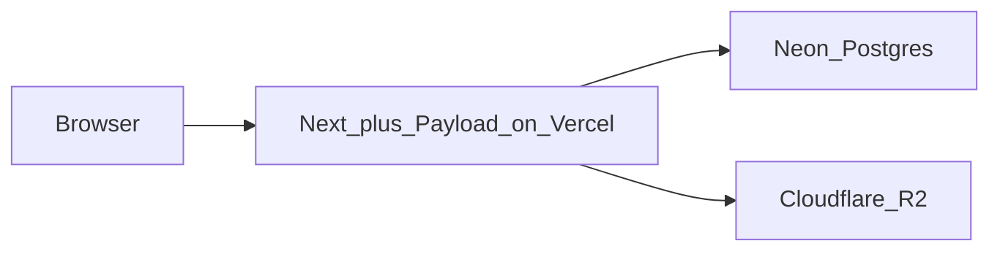

# Blog

Личный блог / персональный сайт автора: статьи и короткие заметки, админка Payload для публикации. Гости читают анонимно — публичной регистрации и комментариев нет ([ADR-007](docs/adr/007-author-only-no-public-auth.md)).

**Live URL:** [https://platenprimeblog.vercel.app](https://platenprimeblog.vercel.app)

**Стек:** Next.js + Payload CMS v3 · Neon PostgreSQL · Cloudflare R2 · деплой на Vercel. Канон — [`docs/tech-stack.md`](docs/tech-stack.md); выбор стека — [ADR-000](docs/adr/000-payload-next-neon-r2.md).

## Архитектура (кратко)

Одно приложение: публичный сайт и `/admin` крутятся в одном Next.js на Vercel. Контент и пользователи — в Postgres (локально Docker, в бою Neon). Медиа — в Cloudflare R2. Автор входит только в админку; гости читают без аккаунта. Публичные адреса с префиксом локали: `/uk`, `/ru`, `/en` (дефолт — украинский).



Полная схема системы (диаграммы и потоки) — [`docs/architecture.md`](docs/architecture.md).

## Quickstart

Нужны Node.js `^24`, npm `>=10`, Docker.

```bash
npm ci
cp .env.example .env
docker compose up -d
npm run migrate
npm run seed:admin
npm run dev
```

Ожидаемо: сайт на [http://localhost:3000](http://localhost:3000), админка на `/admin` (учётка из `ADMIN_*` в `.env`).

Полный onboarding (env, Neon вместо Docker, seed контента, Preview, типичные сбои) — [`docs/LOCAL_SETUP.md`](docs/LOCAL_SETUP.md).

## Документация

### Старт и обзор

| Документ                                                  | Зачем                           |
| --------------------------------------------------------- | ------------------------------- |
| [LOCAL_SETUP.md](docs/LOCAL_SETUP.md)                     | Локальный запуск с нуля         |
| [local-postgres.md](docs/local-postgres.md)               | Docker Compose Postgres         |
| [tech-stack.md](docs/tech-stack.md)                       | Канон технологий и рамки        |
| [architecture.md](docs/architecture.md)                   | Диаграммы и потоки системы      |
| [how-we-built-the-blog.md](docs/how-we-built-the-blog.md) | Ход проекта человеческим языком |

### Продукт и контент

| Документ                                          | Зачем                                                |
| ------------------------------------------------- | ---------------------------------------------------- |
| [content-model.md](docs/content-model.md)         | Коллекции Payload, поля, access                      |
| [glossary.md](docs/glossary.md)                   | Общий язык: Article/Note, admin/guest, draft/preview |
| [design-principles.md](docs/design-principles.md) | UI / UX принципы                                     |
| [seo-checklist.md](docs/seo-checklist.md)         | SEO-артефакты и проверки                             |

### Процесс и качество

| Документ                                                | Зачем                               |
| ------------------------------------------------------- | ----------------------------------- |
| [development-roadmap.md](docs/development-roadmap.md)   | Порядок шагов до / после v1         |
| [post-v1.md](docs/post-v1.md)                           | Горизонт после announce             |
| [testing.md](docs/testing.md)                           | Политика unit / int тестов          |
| [versioning.md](docs/versioning.md)                     | Версии и Changesets                 |
| [release-policy.md](docs/release-policy.md)             | `main` = Production, gate `quality` |
| [production-checklist.md](docs/production-checklist.md) | Pre-go-live / go-live gate          |

### Ops (runbooks)

Индекс: [runbooks/README.md](docs/runbooks/README.md) — deploy, secrets, logs, media, backup.

| Runbook                                                    | Когда                           |
| ---------------------------------------------------------- | ------------------------------- |
| [vercel-connect.md](docs/runbooks/vercel-connect.md)       | GitHub ↔ Vercel, Production env |
| [vercel-preview.md](docs/runbooks/vercel-preview.md)       | Preview на PR                   |
| [secrets.md](docs/runbooks/secrets.md)                     | Где какой ключ                  |
| [branch-protection.md](docs/runbooks/branch-protection.md) | Ruleset на `main`               |
| [vercel-analytics.md](docs/runbooks/vercel-analytics.md)   | Web Analytics + consent         |
| [vercel-logs.md](docs/runbooks/vercel-logs.md)             | Runtime logs, triage            |
| [r2-media.md](docs/runbooks/r2-media.md)                   | Bucket, CORS, upload smoke      |
| [backup-neon.md](docs/runbooks/backup-neon.md)             | PITR / snapshot / pg_dump       |
| [backup-r2.md](docs/runbooks/backup-r2.md)                 | Mirror / cold copy медиа        |

### Security

| Документ                                                            | Зачем                       |
| ------------------------------------------------------------------- | --------------------------- |
| [security/checklist.md](docs/security/checklist.md)                 | Инвентарь и operator must   |
| [security/access-matrix.md](docs/security/access-matrix.md)         | Кто что может               |
| [security/threat-model.md](docs/security/threat-model.md)           | Модель угроз v1             |
| [security/session-hardening.md](docs/security/session-hardening.md) | Cookie / сессии             |
| [security/supply-chain.md](docs/security/supply-chain.md)           | Dependabot, secret scanning |

### ADR

Полный индекс и практика — [`docs/adr/README.md`](docs/adr/README.md) (000–009; 002/006 superseded). Входные якоря: [ADR-000](docs/adr/000-payload-next-neon-r2.md) (стек), [ADR-007](docs/adr/007-author-only-no-public-auth.md) (author-only).

## Скрипты (шпаргалка)

| Команда                              | Назначение                             |
| ------------------------------------ | -------------------------------------- |
| `npm run dev`                        | Dev-сервер                             |
| `npm run migrate` / `migrate:status` | Применить / статус миграций            |
| `npm run seed:admin` / `seed`        | Админ / админ+контент                  |
| `npm run seed:local`                 | Seed через локальный Docker URL        |
| `npm run ci`                         | lint + format:check + typecheck + unit |
| `npm test` / `test:int`              | Unit / integration                     |
| `npm run build` / `start`            | Production build и старт               |
| `npm run format`                     | Prettier по дереву                     |

## License

MIT
