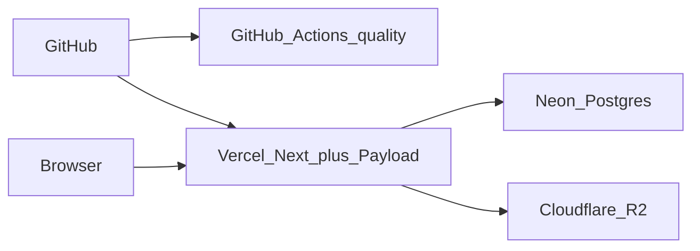
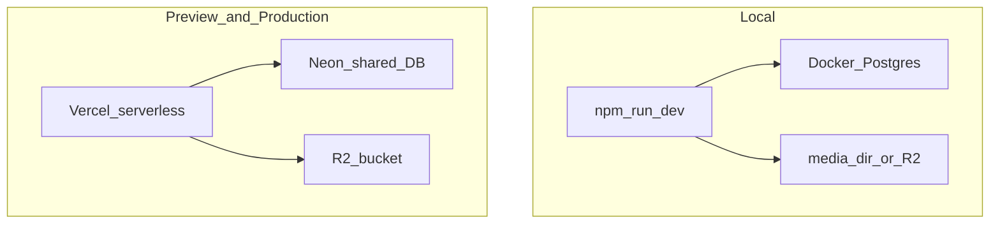
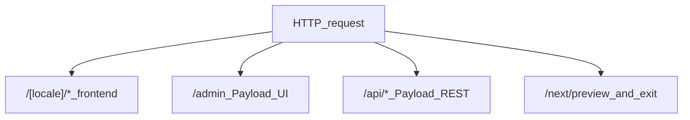
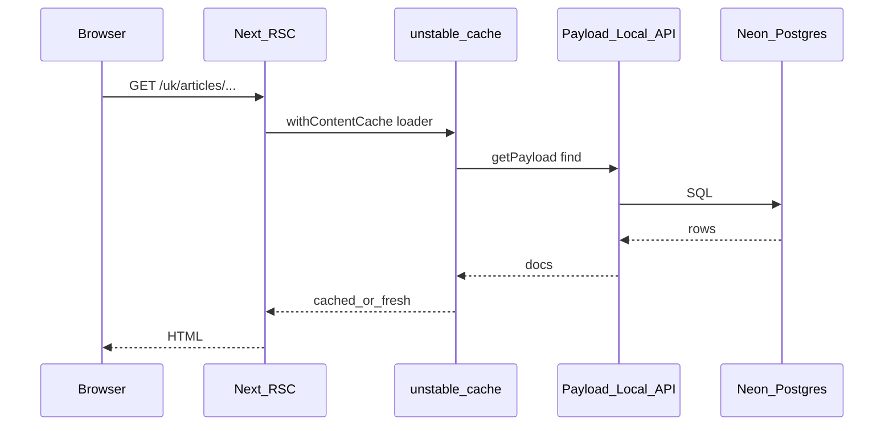
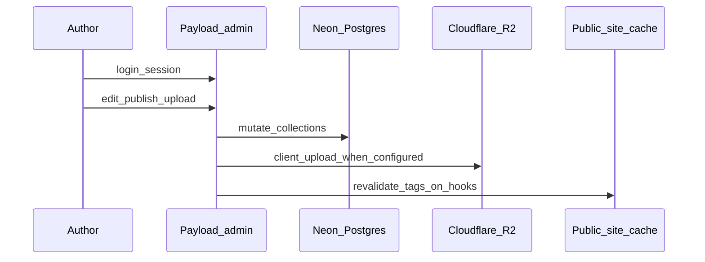
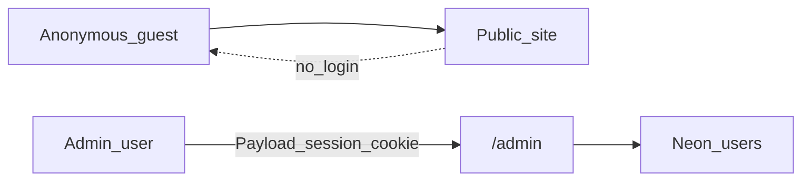
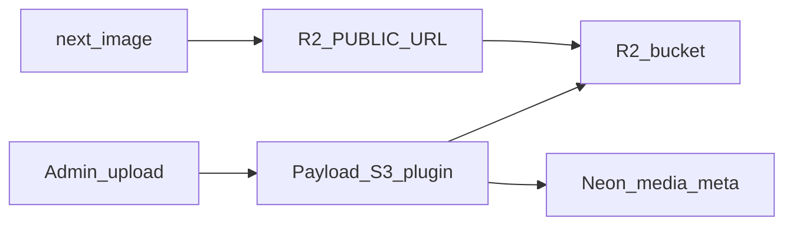

# Архитектура системы

Картинка **как устроено** приложение: куда идёт запрос, где живут данные и кто кому доверяет.

| Документ                                                               | Роль                                         |
| ---------------------------------------------------------------------- | -------------------------------------------- |
| [`tech-stack.md`](./tech-stack.md)                                     | **Что** используем и **зачем**               |
| Этот файл                                                              | **Как** стыкуются слои и потоки              |
| [`adr/000-payload-next-neon-r2.md`](./adr/000-payload-next-neon-r2.md) | Почему один Next+Payload, а не отдельный API |
| [`how-we-built-the-blog.md`](./how-we-built-the-blog.md) (гл. 2)       | Мотивы выбора человеческим языком            |
| [`content-model.md`](./content-model.md)                               | ER коллекций (поля, связи)                   |

Язык: русский + привычные EN-термины (deploy, preview, ISR, access control).

---

## 1. Контекст системы

Один репозиторий, **один Next.js application** на Vercel: публичный сайт и Payload `/admin` в одном процессе/деплое. Отдельного Nest/Express API нет ([ADR-000](./adr/000-payload-next-neon-r2.md)).

- **Vercel** — hosting Preview + Production (`*.vercel.app` на v1).
- **Neon** — PostgreSQL: контент, схема Payload, users (admin).
- **Cloudflare R2** — байты медиа (S3-compatible); метаданные медиа — в Neon.
- **GitHub Actions** — gate `quality` (lint / format / typecheck / unit); деплой делает Vercel из git, не Actions.

Live: [https://platenprimeblog.vercel.app](https://platenprimeblog.vercel.app).

---

## 2. Local vs Preview / Production

| Слой        | Local                                    | Preview / Production                                     |
| ----------- | ---------------------------------------- | -------------------------------------------------------- |
| App         | `npm run dev` / `next start`             | Vercel serverless isolates                               |
| DB adapter  | `@payloadcms/db-postgres` (нет `VERCEL`) | `@payloadcms/db-vercel-postgres` при `VERCEL`            |
| Postgres    | Docker Compose (`docker-compose.yml`)    | Neon; **Preview делит БД с Production**                  |
| Runtime URL | pooled `DATABASE_URL`                    | pooled `DATABASE_URL`                                    |
| Migrations  | `migrate` / `migrate:local`              | `build:deploy` = migrate + build; CLI через unpooled URL |
| Media       | `media/` если R2 env неполный            | R2 при полном наборе `R2_*`                              |

Не ставить `VERCEL=1` в локальный `.env` — иначе форсируется serverless-адаптер против Docker. Детали: [`LOCAL_SETUP.md`](./LOCAL_SETUP.md), [`runbooks/vercel-preview.md`](./runbooks/vercel-preview.md), [ADR-001](./adr/001-migrations-policy.md).

Код выбора адаптера: `src/db/adapter.ts`.

---

## 3. Границы приложения (маршруты)

Один процесс, три класса путей:

| Класс                            | Назначение                                                              |
| -------------------------------- | ----------------------------------------------------------------------- |
| `/(frontend)/[locale]/…`         | Публичный RSC-сайт; префикс локали всегда (`uk` / `ru` / `en`, ADR-004) |
| `/(payload)/admin/…`             | Payload admin UI                                                        |
| `/(payload)/api/…`               | Payload REST (и сгенерированный GraphQL route)                          |
| `/next/preview`, `/exit-preview` | Draft Mode: `PREVIEW_SECRET` + Payload auth; вне locale prefix          |

`src/proxy.ts` (next-intl) матчит только публичные пути: `api`, `admin`, `_next`, `_vercel` и статика исключены из locale middleware.

---

## 4. Потоки данных

### 4.1 Гость читает

Публичные loaders (`src/content/*`) читают через Payload Local API. Кэш: `unstable_cache` + tags, TTL ~60s; хуки публикации инвалидируют теги ([ADR-009](./adr/009-caching-isr-revalidate.md)). Видимость scheduled — в query-time ([ADR-003](./adr/003-scheduled-publish-query-time.md)). RSS / sitemap / search — без того же content-cache, где это зафиксировано в ADR-009.

### 4.2 Admin пишет

Запись контента и users — только через `/admin` (и авторизованный API) с ролью `admin`. После save хуки (`src/hooks/revalidatePublicContent.ts`) обновляют публичный кэш.

---

## 5. Auth и доверие

Продуктовый канон — [ADR-007](./adr/007-author-only-no-public-auth.md): **один admin**, гости **без аккаунтов**.

| Инвариант                         | Реализация                                |
| --------------------------------- | ----------------------------------------- |
| Только роль `admin`               | `src/collections/Users.ts`                |
| Нет public register/login         | Нет reader-маршрутов после pivot          |
| Публичный read опубликованного    | `publishedOrAdmin` / public where helpers |
| Media read публичный; write admin | `src/collections/Media.ts`                |
| Cookie                            | SameSite=Lax; `secure` в production       |

Модель угроз и матрица доступа: [`security/threat-model.md`](./security/threat-model.md), [`security/access-matrix.md`](./security/access-matrix.md).

---

## 6. Медиа (R2)

- Плагин: `src/storage/r2.ts` (`@payloadcms/storage-s3`).
- Включён, когда заданы все: `R2_BUCKET`, keys, `R2_ENDPOINT`, `R2_PUBLIC_URL` (иначе local `media/` + `/api/media/file/...`).
- `clientUploads: true` — байты минуют body limit Vercel; CORS на bucket — [`runbooks/r2-media.md`](./runbooks/r2-media.md).
- `next/image` remotePatterns строятся из `R2_PUBLIC_URL` (`next.config.ts`).

---

## 7. Кэш и свежесть

Кратко (полная политика — [ADR-009](./adr/009-caching-isr-revalidate.md)):

- Публичный контент: `src/cache/withContentCache.ts` — `unstable_cache`, tags, revalidate ~60s.
- AfterChange / AfterDelete хуки на контентных коллекциях → `revalidateTag`.
- Scheduled publish не требует cron: документ «ещё не виден», пока `publishedAt` в будущем (ADR-003); после наступления даты помогает TTL кэша.
- Не кэшировать тем же слоем то, что ADR-009 исключает (RSS, sitemap, search — см. ADR).

---

## 8. Observability и ops

| Что              | Где                                                                  |
| ---------------- | -------------------------------------------------------------------- |
| Runtime logs     | Vercel Logs — [`runbooks/vercel-logs.md`](./runbooks/vercel-logs.md) |
| Web Analytics    | `@vercel/analytics` за consent gate                                  |
| Sentry           | **Не** в v1 — [ADR-008](./adr/008-sentry-waive-until-needed.md)      |
| Deploy / secrets | [`runbooks/README.md`](./runbooks/README.md)                         |
| Backup Neon / R2 | `runbooks/backup-neon.md`, `backup-r2.md`                            |

На диаграммах v1 **нет** отдельного Sentry/APM-бокса.

---

## 9. Что сознательно не является частью живой схемы

После author-only pivot ([ADR-007](./adr/007-author-only-no-public-auth.md)) **не** рисуем как действующие сервисы:

| Было / рассматривалось       | Статус                                 |
| ---------------------------- | -------------------------------------- |
| Public auth, OAuth           | Снято; ADR-002 superseded для продукта |
| Resend / transactional email | Снято с продукта                       |
| Upstash / rate limit         | Снято; ADR-006 superseded для продукта |
| Cloudflare Turnstile         | Снято с продукта                       |
| Reader comments / bookmarks  | Удалены миграцией `drop_reader_social` |
| Отдельный Redis-кэш          | Не вводили (tech-stack)                |
| Neon branch-per-PR           | Не сделано; Preview = shared Neon      |
| `vercel.json` в репо         | Нет; настройки в UI Vercel             |

Исторические шаги роадмапа остаются `done` как история; читать Product DoD и этот файл как «как сейчас».

---

## 10. Связанные схемы

- Коллекции и связи — ER в [`content-model.md`](./content-model.md).
- Краткий mermaid на входе — [`README.md`](../README.md).
- Индекс ADR — [`adr/README.md`](./adr/README.md).
- Глоссарий терминов — [`glossary.md`](./glossary.md).
