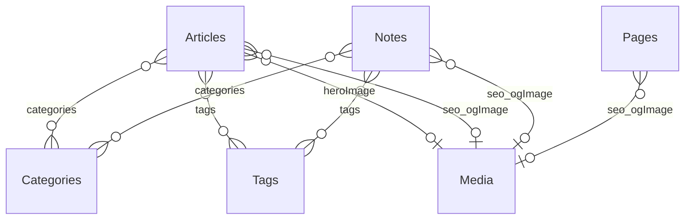

# Content model

Человекочитаемая схема данных Payload CMS v3 для этого блога.

**Источник правды в коде:** [`src/payload.config.ts`](../src/payload.config.ts), коллекции в [`src/collections/`](../src/collections/), access-хелперы в [`src/access/`](../src/access/). Сгенерированные типы — [`src/payload-types.ts`](../src/payload-types.ts) (не дублируем здесь целиком).

**Продукт (author-only):** один admin, гости без аккаунтов — [ADR-007](./adr/007-author-only-no-public-auth.md). Collections `comments` / `bookmarks` удалены миграцией `20261112_130000_drop_reader_social`.

## Глобальные настройки

| Параметр     | Значение                                                                                       |
| ------------ | ---------------------------------------------------------------------------------------------- |
| Locales      | `uk` (default), `ru`, `en`; `fallback: true`                                                   |
| Rich text    | Lexical (`src/editor/lexical.ts`): default features + `UploadFeature(media)` + block `youtube` |
| Upload limit | `MEDIA_MAX_FILE_SIZE` = 5 MiB (глобальный `upload.limits.fileSize`)                            |
| Admin users  | коллекция `users` (`admin` only)                                                               |
| Timestamps   | Payload default: `createdAt` / `updatedAt` на всех коллекциях                                  |
| Trash        | не используется                                                                                |

Порядок регистрации коллекций (admin.group UX): `articles` → `notes` → `pages` → `media` → `categories` → `tags` → `users`.

### Editorial localization + fallback (шаг **043**)

Один документ — три локали (`uk` / `ru` / `en`), не три отдельных записи. Публичный URL и Payload Local API передают `locale` из префикса (`resolveContentLocale` в [`src/i18n/contentLocale.ts`](../src/i18n/contentLocale.ts)); временный preview — [`loadPreviewDoc`](<../src/app/(frontend)/[locale]/dev/rich-text/loadPreviewDoc.ts>).

| Политика | Правило                                                                                                                                         |
| -------- | ----------------------------------------------------------------------------------------------------------------------------------------------- |
| Default  | `uk` — и Payload `defaultLocale`, и публичный default (ADR-004)                                                                                 |
| Fallback | `fallback: true`: пустое локализованное поле в запрошенной локали → значение из `uk`                                                            |
| Редактор | Заполняет локали **осознанно**: `uk` как база; `ru`/`en` — когда есть перевод; пустая локаль = сознательный fallback на `uk`, не «забыли схему» |
| Slug     | Локализован; уникальность **per locale** `(slug, _locale)`                                                                                      |

**Localized:** `title`, `slug`, `body`, `searchText` (Articles / Notes), `seo.metaTitle`, `seo.metaDescription` (Articles / Notes / Pages); у Categories / Tags — `title`, `slug`.

**Не localized (общие на документ):** `heroImage`, `categories`, `tags`, `publishedAt`, `seo.ogImage`, `_status`, timestamps.

Полная политика дыр (URL 404 vs chrome key path vs Payload `uk`) — [ADR-005](./adr/005-i18n-fallback-and-missing.md); chrome JSON **не** мержится с `uk` в runtime. Language switcher — **044** (done). Продуктовые маршруты статей/заметок/страниц и ремап slug между локалями — Track 5.

## Связи

- Pages — статические страницы без taxonomy (`categories` / `tags`) и без `heroImage`.
- Публичный UI: гости делятся ссылкой на article/note (`ShareActions`); отдельной коллекции под share нет.

## Shared building blocks

### Taxonomy (`taxonomyFields.ts`)

Используется в Categories, Tags, Articles, Notes, Pages:

| Поле    | Тип  | Notes                                         |
| ------- | ---- | --------------------------------------------- |
| `title` | text | required, localized                           |
| `slug`  | text | required, unique, localized, indexed; sidebar |

Hook `ensureSlugFromTitle` (`beforeValidate`): если `slug` пустой/whitespace и есть `title` → `slugify(title)`.

### Slugify (`src/lib/slugify.ts`)

URL-safe сегмент: карта кириллицы uk/ru → латиница, NFKD, снятие диакритики, lower case, пробелы/не-alphanumeric → дефисы.

### SEO group (`seoFields.ts`)

Группа `seo` на Articles, Notes, Pages:

| Поле              | Тип              | Notes                                                                                             |
| ----------------- | ---------------- | ------------------------------------------------------------------------------------------------- |
| `metaTitle`       | text             | localized                                                                                         |
| `metaDescription` | textarea         | localized                                                                                         |
| `ogImage`         | upload → `media` | не localized; публичный OG (069): `seo.ogImage` → `heroImage` (статьи) → ImageResponse title card |

### Media limits (`mediaLimits.ts`)

| Константа                | Значение                                                    |
| ------------------------ | ----------------------------------------------------------- |
| `MEDIA_MAX_FILE_SIZE`    | 5 MiB                                                       |
| `MEDIA_MIME_TYPES`       | Input: `image/jpeg`, `image/png`, `image/webp`, `image/gif` |
| `mediaWebpFormatOptions` | Sharp → `webp` quality `MEDIA_WEBP_QUALITY` (80)            |

## Access helpers (`src/access/`)

| Helper             | Поведение                                                                                           |
| ------------------ | --------------------------------------------------------------------------------------------------- |
| `isAdmin`          | `user.role === 'admin'`                                                                             |
| `publishedOrAdmin` | admin → все; иначе `publicContentWhere` (`_status published` + `publishedAt` не в будущем, ADR-003) |

Вспомогательный where-фрагмент: `publicContentWhere` в [`src/access/publicContentWhere.ts`](../src/access/publicContentWhere.ts).

Роль: `admin` only (`AccessUser` / `UserRole` в `types.ts`).

### Draft Preview (шаг 035)

| Часть | Деталь                                                                       |
| ----- | ---------------------------------------------------------------------------- |
| Env   | `PREVIEW_SECRET`                                                             |
| Admin | `admin.preview` на Articles / Notes / Pages → `/next/preview?...`            |
| Gate  | секрет + session `role: admin` + allowlist path (`src/preview/paths.ts`)     |
| Front | Next.js `draftMode`; temporary `/dev/rich-text/{article\|note\|page}/[slug]` |
| Exit  | `/next/exit-preview`                                                         |

### Scheduled publish (шаг 036 / ADR-003)

| Часть      | Деталь                                                               |
| ---------- | -------------------------------------------------------------------- |
| Visibility | `_status: published` и (`publishedAt` пуст/null или `<= now`)        |
| Access     | `publicContentWhere` внутри `publishedOrAdmin`                       |
| Hook       | `setPublishedAtOnPublish` — пустой `publishedAt` при Publish → `now` |
| Not used   | Vercel cron для flip `_status`                                       |

---

## Коллекции

### `users` — Users

Аккаунты **только admin** для `/admin`. Публичной регистрации нет (ADR-007).

|                |                                                                                                          |
| -------------- | -------------------------------------------------------------------------------------------------------- |
| Auth           | email/password в Payload; cookies SameSite=Lax; без verify / forgot email / OAuth                        |
| Drafts / trash | нет                                                                                                      |
| Access         | `admin` panel + create/read/update/delete — **только admin**; bootstrap через seed или create-first-user |
| Hooks          | create → force `role: admin`                                                                             |

| Поле     | Тип             | Notes                                                    |
| -------- | --------------- | -------------------------------------------------------- |
| _(auth)_ | email, password | Payload auth                                             |
| `role`   | select          | required; default `admin`; единственное значение `admin` |

### `media` — Media

Изображения: local disk или R2; originals → WebP.

|        |                                                                                                             |
| ------ | ----------------------------------------------------------------------------------------------------------- |
| Upload | Local `media/` или R2 (**037**); MIME input `MEDIA_MIME_TYPES`; `formatOptions` → WebP quality 80 (**038**) |
| Access | `read`: публичный; create/update/delete: **admin only** (**039**)                                           |
| Hooks  | нет                                                                                                         |

| Поле            | Тип                                  | Notes           |
| --------------- | ------------------------------------ | --------------- |
| `alt`           | text                                 | required (a11y) |
| _(upload meta)_ | filename, mimeType, filesize, url, … | Payload upload  |

### `categories` — Categories

|        |                                    |
| ------ | ---------------------------------- |
| Access | `read`: публичный; CUD: admin only |
| Hooks  | `ensureSlugFromTitle`              |
| Fields | `title`, `slug` (taxonomy)         |

### `tags` — Tags

Та же форма, что Categories (`slug: tags`).

### `articles` — Articles

Длинный контент с обложкой и taxonomy.

|          |                                                                           |
| -------- | ------------------------------------------------------------------------- |
| Versions | `drafts: true` → `_status` draft / published                              |
| Access   | `read`: `publishedOrAdmin`; CUD: admin only                               |
| Hooks    | `ensureSlugFromTitle`; `setPublishedAtOnPublish`; `setSearchTextFromBody` |

| Поле          | Тип                         | Required | Localized | Notes                                                                            |
| ------------- | --------------------------- | -------- | --------- | -------------------------------------------------------------------------------- |
| `title`       | text                        | yes      | yes       | taxonomy                                                                         |
| `slug`        | text                        | yes      | yes       | unique, indexed                                                                  |
| `body`        | richText                    | yes      | yes       | Lexical: Media upload + block `youtube` (sanitize URL → youtube-nocookie)        |
| `searchText`  | textarea                    | no       | yes       | hidden; plaintext из `body` для ILIKE-поиска (066); хук + `backfill:search-text` |
| `heroImage`   | upload → `media`            | no       | —         | обложка                                                                          |
| `categories`  | relationship → `categories` | no       | —         | hasMany, sidebar                                                                 |
| `tags`        | relationship → `tags`       | no       | —         | hasMany, sidebar                                                                 |
| `publishedAt` | date                        | no       | —         | dayAndTime; empty→now on Publish; future = scheduled (ADR-003)                   |
| `seo`         | group                       | —        | nested    | см. SEO group                                                                    |
| `_status`     | (drafts)                    | —        | —         | через versions                                                                   |

### `notes` — Notes

Короткие заметки. Как Articles, **кроме**:

- нет `heroImage`;
- у `body` admin-описание: short-form note.

Drafts, access, taxonomy, `publishedAt`, `searchText`, SEO — те же.

### `pages` — Pages

Статические страницы (About, Privacy, Terms и т.п.).

|          |                                |
| -------- | ------------------------------ |
| Versions | drafts                         |
| Access   | `publishedOrAdmin` / admin CUD |
| Hooks    | `ensureSlugFromTitle`          |

Поля: taxonomy `title`/`slug` + localized required `body` + `publishedAt` + `seo`.  
**Нет** `heroImage`, `categories`, `tags`.

---

## Сводная матрица

| Collection | Auth | Drafts | Public / default read   | Localized fields                     | Slug auto | CUD   |
| ---------- | ---- | ------ | ----------------------- | ------------------------------------ | --------- | ----- |
| users      | yes  | no     | admin only              | —                                    | —         | admin |
| media      | no   | no     | all                     | —                                    | —         | admin |
| categories | no   | no     | all                     | title, slug                          | yes       | admin |
| tags       | no   | no     | all                     | title, slug                          | yes       | admin |
| articles   | no   | yes    | published (+ admin all) | title, slug, body, searchText, seo.* | yes       | admin |
| notes      | no   | yes    | published (+ admin all) | title, slug, body, searchText, seo.* | yes       | admin |
| pages      | no   | yes    | published (+ admin all) | title, slug, body, seo.*             | yes       | admin |

**Articles vs Notes vs Pages:** Articles = Notes + `heroImage`; Pages без taxonomy-relations и без hero.

## Сознательные ограничения v1

- Media: local disk или R2; originals → WebP; CUD admin-only (**039**).
- Нет reader accounts, comments, bookmarks (ADR-007).
- Schedule: query-time visibility по `publishedAt` (ADR-003), без cron.
- Полная матрица ACL — [`security/access-matrix.md`](./security/access-matrix.md).
