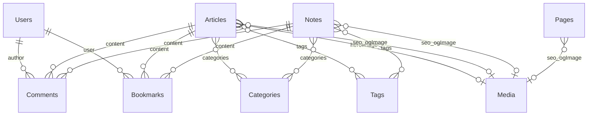

# Content model

Человекочитаемая схема данных Payload CMS v3 для этого блога.

**Источник правды в коде:** [`src/payload.config.ts`](../src/payload.config.ts), коллекции в [`src/collections/`](../src/collections/), access-хелперы в [`src/access/`](../src/access/). Сгенерированные типы — [`src/payload-types.ts`](../src/payload-types.ts) (не дублируем здесь целиком).

## Глобальные настройки

| Параметр     | Значение                                                                                       |
| ------------ | ---------------------------------------------------------------------------------------------- |
| Locales      | `uk` (default), `ru`, `en`; `fallback: true`                                                   |
| Rich text    | Lexical (`src/editor/lexical.ts`): default features + `UploadFeature(media)` + block `youtube` |
| Upload limit | `MEDIA_MAX_FILE_SIZE` = 5 MiB (глобальный `upload.limits.fileSize`)                            |
| Admin users  | коллекция `users`                                                                              |
| Timestamps   | Payload default: `createdAt` / `updatedAt` на всех коллекциях                                  |
| Trash        | не используется                                                                                |

Порядок регистрации коллекций (admin.group UX, шаг **033**): `articles` → `notes` → `pages` → `media` → `categories` → `tags` → `comments` → `bookmarks` → `users`.

## Связи

- Comments и Bookmarks ссылаются на контент **полиморфно**: только `articles` \| `notes` (не `pages`).
- Pages — статические страницы без taxonomy (`categories` / `tags`) и без `heroImage`.

## Shared building blocks

### Taxonomy (`taxonomyFields.ts`)

Используется в Categories, Tags, Articles, Notes, Pages:

| Поле    | Тип  | Notes                                         |
| ------- | ---- | --------------------------------------------- |
| `title` | text | required, localized                           |
| `slug`  | text | required, unique, localized, indexed; sidebar |

Hook `ensureSlugFromTitle` (`beforeValidate`): если `slug` пустой/whitespace и есть `title` → `slugify(title)`.

### Slugify (`src/lib/slugify.ts`)

URL-safe сегмент: карта кириллицы uk/ru → латиница, NFKD, снятие диакритики, lower case, пробелы/не-alphanumeric → дефисы.

### SEO group (`seoFields.ts`)

Группа `seo` на Articles, Notes, Pages:

| Поле              | Тип              | Notes        |
| ----------------- | ---------------- | ------------ |
| `metaTitle`       | text             | localized    |
| `metaDescription` | textarea         | localized    |
| `ogImage`         | upload → `media` | не localized |

### Media limits (`mediaLimits.ts`)

| Константа                | Значение                                                    |
| ------------------------ | ----------------------------------------------------------- |
| `MEDIA_MAX_FILE_SIZE`    | 5 MiB                                                       |
| `MEDIA_MIME_TYPES`       | Input: `image/jpeg`, `image/png`, `image/webp`, `image/gif` |
| `mediaWebpFormatOptions` | Sharp → `webp` quality `MEDIA_WEBP_QUALITY` (80)            |

### Bookmark uniqueness (`bookmarkUniqueness.ts`)

Хелперы для проверки дубликата `(user, content.relationTo, content.value)` на уровне приложения (не DB unique index). При конфликте hook бросает `APIError` **409**.

## Access helpers (`src/access/`)

| Helper             | Поведение                                                                                           |
| ------------------ | --------------------------------------------------------------------------------------------------- |
| `isAdmin`          | `user.role === 'admin'`                                                                             |
| `isAuthenticated`  | есть `user.id`                                                                                      |
| `isSelfOrAdmin`    | admin → все; auth → свой документ по `id`; иначе deny                                               |
| `isOwnerOrAdmin`   | admin → все; auth → документы, где поле `user` = session; иначе deny                                |
| `publishedOrAdmin` | admin → все; иначе `publicContentWhere` (`_status published` + `publishedAt` не в будущем, ADR-003) |
| `approvedOrAdmin`  | admin → все; иначе `moderationStatus equals approved`                                               |

Роли пользователя: `admin` \| `reader` (`AccessUser` / `UserRole` в `types.ts`).

### Draft Preview (шаг 035)

| Часть | Деталь                                                                       |
| ----- | ---------------------------------------------------------------------------- |
| Env   | `PREVIEW_SECRET`                                                             |
| Admin | `admin.preview` на Articles / Notes / Pages → `/next/preview?...`            |
| Gate  | секрет + session `role: admin` + allowlist path (`src/preview/paths.ts`)     |
| Front | Next.js `draftMode`; temporary `/dev/rich-text/{article\|note\|page}/[slug]` |
| Exit  | `/next/exit-preview`                                                         |

### Scheduled publish (шаг 036 / ADR-003)

| Часть      | Деталь                                                               |
| ---------- | -------------------------------------------------------------------- |
| Visibility | `_status: published` и (`publishedAt` пуст/null или `<= now`)        |
| Access     | `publicContentWhere` внутри `publishedOrAdmin`                       |
| Hook       | `setPublishedAtOnPublish` — пустой `publishedAt` при Publish → `now` |
| Not used   | Vercel cron для flip `_status`                                       |

---

## Коллекции

### `users` — Users

Аккаунты: один admin в админке + будущие readers на сайте.

|                |                                                                                                          |
| -------------- | -------------------------------------------------------------------------------------------------------- |
| Auth           | email/password + verify + forgotPassword; cookies SameSite=Lax; Google OAuth optional (`payload-oauth2`) |
| Drafts / trash | нет                                                                                                      |
| Access         | `admin`: только admin; `create`: public (self-register); `read` / `update` / `delete`: `isSelfOrAdmin`   |
| Hooks          | first user → `role: admin` + `_verified: true`; non-admin create → force `role: reader`                  |

| Поле     | Тип                | Notes                                                                                  |
| -------- | ------------------ | -------------------------------------------------------------------------------------- |
| _(auth)_ | email, password, … | Payload auth + `_verified` / verification & reset tokens                               |
| `role`   | select             | required; default `reader`; `admin` \| `reader`; create/update поля — **только admin** |
| `sub`    | text               | OAuth subject (Google); set by plugin                                                  |

### `media` — Media

Изображения: local disk или R2; originals → WebP.

|        |                                                                                                             |
| ------ | ----------------------------------------------------------------------------------------------------------- |
| Upload | Local `media/` или R2 (**037**); MIME input `MEDIA_MIME_TYPES`; `formatOptions` → WebP quality 80 (**038**) |
| Access | `read`: публичный; create/update/delete: **admin only** (**039**)                                           |
| Hooks  | нет                                                                                                         |

| Поле            | Тип                                  | Notes           |
| --------------- | ------------------------------------ | --------------- |
| `alt`           | text                                 | required (a11y) |
| _(upload meta)_ | filename, mimeType, filesize, url, … | Payload upload  |

### `categories` — Categories

|        |                                    |
| ------ | ---------------------------------- |
| Access | `read`: публичный; CUD: admin only |
| Hooks  | `ensureSlugFromTitle`              |
| Fields | `title`, `slug` (taxonomy)         |

### `tags` — Tags

Та же форма, что Categories (`slug: tags`).

### `articles` — Articles

Длинный контент с обложкой и taxonomy.

|          |                                                  |
| -------- | ------------------------------------------------ |
| Versions | `drafts: true` → `_status` draft / published     |
| Access   | `read`: `publishedOrAdmin`; CUD: admin only      |
| Hooks    | `ensureSlugFromTitle`; `setPublishedAtOnPublish` |

| Поле          | Тип                         | Required | Localized | Notes                                                                     |
| ------------- | --------------------------- | -------- | --------- | ------------------------------------------------------------------------- |
| `title`       | text                        | yes      | yes       | taxonomy                                                                  |
| `slug`        | text                        | yes      | yes       | unique, indexed                                                           |
| `body`        | richText                    | yes      | yes       | Lexical: Media upload + block `youtube` (sanitize URL → youtube-nocookie) |
| `heroImage`   | upload → `media`            | no       | —         | обложка                                                                   |
| `categories`  | relationship → `categories` | no       | —         | hasMany, sidebar                                                          |
| `tags`        | relationship → `tags`       | no       | —         | hasMany, sidebar                                                          |
| `publishedAt` | date                        | no       | —         | dayAndTime; empty→now on Publish; future = scheduled (ADR-003)            |
| `seo`         | group                       | —        | nested    | см. SEO group                                                             |
| `_status`     | (drafts)                    | —        | —         | через versions                                                            |

### `notes` — Notes

Короткие заметки. Как Articles, **кроме**:

- нет `heroImage`;
- у `body` admin-описание: short-form note.

Drafts, access, taxonomy, `publishedAt`, SEO — те же.

### `pages` — Pages

Статические страницы (About, Privacy, Terms и т.п.).

|          |                                |
| -------- | ------------------------------ |
| Versions | drafts                         |
| Access   | `publishedOrAdmin` / admin CUD |
| Hooks    | `ensureSlugFromTitle`          |

Поля: taxonomy `title`/`slug` + localized required `body` + `publishedAt` + `seo`.  
**Нет** `heroImage`, `categories`, `tags`.

### `comments` — Comments

|        |                                                                                                |
| ------ | ---------------------------------------------------------------------------------------------- |
| Access | `read`: `approvedOrAdmin`; `create`: authenticated **and** verified; update/delete: admin only |
| Hooks  | `setAuthorFromUser`: на create `author = req.user.id` (anti-spoof)                             |

| Поле               | Тип                    | Required | Notes                                                                       |
| ------------------ | ---------------------- | -------- | --------------------------------------------------------------------------- |
| `content`          | relationship           | yes      | polymorphic → `articles` \| `notes`                                         |
| `author`           | relationship → `users` | yes      | readOnly в admin; ставит hook                                               |
| `body`             | textarea               | yes      |                                                                             |
| `moderationStatus` | select                 | yes      | default `approved`; `approved` \| `hidden`; create/update поля — admin only |

### `bookmarks` — Bookmarks

|        |                                                                                                         |
| ------ | ------------------------------------------------------------------------------------------------------- |
| Access | `read` / `update` / `delete`: `isOwnerOrAdmin`; `create`: authenticated **and** verified                |
| Hooks  | (1) `setUserFromSession` на create; (2) `rejectDuplicateBookmark` → 409 при дубликате `(user, content)` |

| Поле      | Тип                    | Required | Notes                               |
| --------- | ---------------------- | -------- | ----------------------------------- |
| `user`    | relationship → `users` | yes      | readOnly; ставит hook               |
| `content` | relationship           | yes      | polymorphic → `articles` \| `notes` |

Уникальность — **application-level** (hook), не unique index в БД.

---

## Сводная матрица

| Collection | Auth | Drafts | Public / default read   | Localized fields         | Slug auto | CUD                           |
| ---------- | ---- | ------ | ----------------------- | ------------------------ | --------- | ----------------------------- |
| users      | yes  | no     | self / admin            | —                        | —         | create public; RUD self/admin |
| media      | no   | no     | all                     | —                        | —         | default authenticated         |
| categories | no   | no     | all                     | title, slug              | yes       | admin                         |
| tags       | no   | no     | all                     | title, slug              | yes       | admin                         |
| articles   | no   | yes    | published (+ admin all) | title, slug, body, seo.* | yes       | admin                         |
| notes      | no   | yes    | published (+ admin all) | title, slug, body, seo.* | yes       | admin                         |
| pages      | no   | yes    | published (+ admin all) | title, slug, body, seo.* | yes       | admin                         |
| comments   | no   | no     | approved (+ admin all)  | —                        | —         | create auth; UD admin         |
| bookmarks  | no   | no     | owner / admin           | —                        | —         | create auth; RUD owner/admin  |

**Articles vs Notes vs Pages:** Articles = Notes + `heroImage`; Pages без taxonomy-relations и без hero.

## Сознательные ограничения v1

- Bookmark uniqueness на hook, не на DB constraint (гонка возможна теоретически; усиление — отдельный шаг при необходимости).
- Comments / Bookmarks не цепляются к `pages`.
- Media: local disk или R2; originals → WebP; CUD admin-only (**039**).
- Поле `role` меняет только admin; публичный `create` users — self-register readers (`/uk/register`, ADR-004) + first-user admin bootstrap.
- Comments/Bookmarks create: `isAuthenticatedAndVerified` (ADR-002). Полная матрица — [`security/access-matrix.md`](./security/access-matrix.md).
- Schedule: query-time visibility по `publishedAt` (ADR-003), без cron.
- Soft-moderation комментариев в публичном UI — с шага 058.
