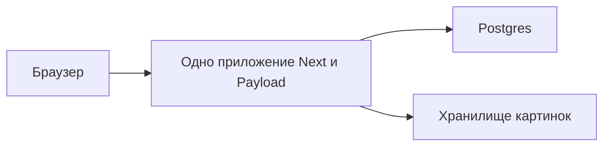

# Как мы делали блог

Дописано по шаг **053**. Следующий по чертежу — **054** (страница «об авторе»).
Дата этой редакции: 26 октября 2026.

Это не чертёж. Чертёж лежит рядом: [development-roadmap.md](./development-roadmap.md). Там у каждого шага есть цель, список того, что должно появиться, и способ проверить, что оно появилось. По чертежу можно работать. Понять, _зачем_ шаг вообще случился, по нему трудно: ранние пункты выглядят как ритуал, поздние — как внезапные фичи.

Эта книга — второй документ. Она рассказывает ход. Если ты открыл проект и никогда не собирал сайт на Next.js, не трогал Payload и не думал, зачем базе отдельно от картинок, читай отсюда. Термины объясняются в тот момент, когда они впервые понадобились, на примере этого блога, а не абстрактного «веб-приложения».

Номера шагов в скобках — якоря. Увидел `(007)` — при желании открой чертёж и найди шаг 007. Книга от этого не становится списком.

Как читать, если бросил на середине. Главы идут в том порядке, в котором проект обретал форму: сначала «что мы строим», потом мастерская, потом форма данных, потом люди и права, потом стол автора, потом языки в адресе, потом краска и тема. Последняя глава честно говорит, чего ещё нет. Команд «запусти это» здесь нет — для этого есть [LOCAL_SETUP.md](./LOCAL_SETUP.md).

Когда закроется очередной кусок работ, соответствующую главу дописываем в том же голосе. Глава про публичные страницы доведена до полок рубрик и тегов. Страница «об авторе» ещё впереди.

---

## 1. Зачем этот файл

Представь, что ты пришёл в квартиру на середине ремонта. На полу рулоны, на стене карандашные отметки розеток, кухни ещё нет, но водопровод уже разведён именно так, а не иначе. Человек с рулеткой может сказать: «здесь будет смеситель, допуск два миллиметра». Это полезно тому, кто сверлит. Тебе, если ты хочешь понять квартиру, нужно другое: почему смеситель у окна, почему проводку тянули до плитки, и почему гостиную не красили первой.

Roadmap — рулетка. Эта книга — разговор на объекте.

Мы сознательно не стали пересказывать чертёж другими словами. Если абзац можно заменить строкой «сделали коллекцию Articles», его здесь быть не должно. Здесь должно быть: какую боль это снимает, что сломается, если сделать наоборот, и как этот кусок держит следующий.

Ещё одна договорённость о честности. Сделано не всё. Сайт, который можно дать почитать маме, ещё не собран: главная с именем и общая лента уже есть, страницы отдельной статьи ещё нет, нет кнопки «комментировать». Зато уже есть то, без чего эти кнопки были бы декорацией: кто такой автор, кто такой читатель, что считается статьёй, когда текст считается опубликованным, куда девается картинка, как человек доказывает, что почта его. Строить фасад раньше этого — обычная ошибка. Потом фасад сносят, потому что за ним не оказалось несущих стен.

---

## 2. Что мы вообще строим

Личный блог одного автора. Не редакция, не платформа для тысячи блогеров, не магазин. Один человек пишет. Другие люди читают. Если им этого мало, они заводят аккаунт и оставляют след: комментарий или закладку. Платного контента нет. Рассылки нет. Видео мы не храним у себя — если в тексте нужно видео, это ролик с YouTube, вставленный как ссылка.

Текста два сорта, и это не каприз.

Статья — длинная вещь. У неё есть обложка, рубрики, теги, нормальный заголовок в адресе страницы. Её читают сидя.

Заметка — короткая мысль. Отдельный ящик, отдельный адрес, визуально легче, когда до неё дойдёт очередь на сайте. Если смешать их в одну кучу «постов», через месяц ты сам не вспомнишь, почему у одной записи нет обложки, а у другой есть. Два ящика с первого дня дешевле, чем один ящик и вечные оговорки.

Рядом со статьями и заметками живут обычные страницы: об авторе, потом политика конфиденциальности и условия. Их не хочется навсегда зашивать в вёрстку. Автор должен править «Обо мне» там же, где правит статью. Поэтому у страниц свой ящик, попроще: без рубрик и без обложки.

Языков три: украинский, русский, английский. Украинский — язык по умолчанию. Это решение продукта, не случайность алфавита. Сайт должен уметь отдать одну и ту же статью на трёх языках, а интерфейс — подписи кнопок, ошибки, меню — тоже. Мы ещё не дошли до слов в кнопках. Мы дошли до решения, что язык виден в адресе: `/uk/...`, `/ru/...`, `/en/...`. Почему адрес раньше слов — отдельная глава, и она в конце уже сделанного. Здесь важно другое: три языка заложены в фундамент, а не «добавим локализацию потом плагином».

Картинки не лежат на диске того компьютера, где крутится сайт. В бою они лежат в объектном хранилище Cloudflare R2. Это по сути чужой жёсткий диск с адресом у каждой картинки. Текст и люди живут в базе PostgreSQL (в бою это Neon, локально — Postgres в Docker). Разделение скучное и правильное: текст маленький и его надо искать, фильтровать, связывать с автором. Картинка тяжёлая, её надо отдать браузеру и не тащить через базу. Бесплатные лимиты базы кончаются на гигабайтах. Бесплатный смысл R2 в том, что отдавать файлы читателям обычно не стоит как отдача из базы.

Кто в системе.

Автор — один. В данных он пользователь с ролью `admin`. Он входит в `/admin` и публикует.

Читатель — пользователь с ролью `reader`. Он регистрируется сам, почтой или через Google. Ему нельзя в админку. Ему можно комментировать и ставить закладки, и только после того, как почта подтверждена.

Гость — никто. Он читает опубликованное. Писать ему некуда, пока не представится.

Роли лежат в одной таблице пользователей, не в двух разных системах входа. Это сэкономит нам очень много боли в главе про вход: «вошёл через Google» не выдаёт ключ от админки, потому что Google создаёт читателя, а роль меняет только админ.

### Одно приложение, а не сайт плюс «бэкенд»

Здесь стоит остановиться, потому что это решение окрашивает всё остальное. Сухая версия — [adr/000-payload-next-neon-r2.md](./adr/000-payload-next-neon-r2.md). Живая версия такая.

Сайт на современный манер — это программа на Node.js. Node — среда, в которой JavaScript живёт не только в браузере, но и на сервере. Мы пишем на TypeScript: это тот же JavaScript, только с заранее объявленными типами, чтобы опечатка в поле `publishedAt` всплыла до того, как её увидит читатель.

Каркас сайта — Next.js, его нынешний способ раскладывать страницы называется App Router. Грубо: папка в проекте — это адрес на сайте. Next умеет собирать страницу на сервере в момент запроса (это SSR: сервер отдал уже готовый HTML, поисковику и человеку не нужно ждать, пока браузер сам дорисует текст) и умеет подержать готовую страницу в кэше, чтобы не спрашивать базу на каждого гостя (это ISR и родственные ему стратегии; к ним мы ещё не подошли, но стек выбран так, чтобы это было штатно).

Админка — Payload CMS версии 3. CMS здесь не «вордпресс с темами». Payload — это описание твоих данных (коллекции: пользователи, статьи, медиа), готовая админка на `/admin`, правила «кто может читать и писать», и программный вход в эти данные из нашего же кода. Этот вход называется Local API: серверный код Next вызывает Payload в том же процессе, без отдельного HTTP-запроса на «другой сервер».

Отдельный сервер API мы не заводили. Nest, Express, свой GraphQL — отвергнуто для этой версии. Причины земные.

Один деплой. Сайт и админка выезжают на Vercel одной пачкой. Нет второго сервиса, который надо кормить секретами, будить из холодного старта и держать в одной версии типов с сайтом.

Payload уже является бэкендом. Админка, таблицы, права, загрузка файлов — это он. Писать рядом ещё один слой «на всякий случай» значит дважды описывать статью: один раз для админки, второй раз для своего API, и потом героически синхронизировать.

Масштаб. Один автор, без мультиарендности, без очередей, без биллинга. Отдельный API начал бы окупаться, если бы появилась жизнь, которую Payload выражает плохо. Тогда пишется новое решение, а не тихий второй сервер «на выходных».

То же и с базой. Под Payload лежит адаптер Postgres, а внутри него Drizzle — инструмент, который превращает описание коллекций в таблицы и миграции. Свой Prisma поверх этого мы не кладём. Два описателя схемы начинают врать друг другу в первую же неделю.

Картина, которую стоит держать в голове:

Локально «хранилище картинок» может быть просто папкой `media/` на диске. В бою это R2. Код один, переключается наличием ключей. Об этом будет в мастерской автора.

Хостинг v1 — адрес вида `*.vercel.app`. Свой домен сознательно позже. База в бою — Neon, бесплатный ярус которого для личного блога с кэшем страниц достаточен, потому что тяжёлые байты живут не в ней. Пока прод не подключён. Локально мы не ждём Neon: Postgres поднимается в Docker, и день не зависит от интернета и чужого кабинета.

Вот рамка. Дальше — почему первые две недели выглядели так, будто блога нет.

---

## 3. Сначала мастерская, потом стены

Шаги 001–014. Со стороны это тоска: README, версия Node, линтер, проверка типов, файл с примером переменных, Docker, политика миграций, два тестовых раннера, GitHub Actions, инструкция по запуску, документ «почему такой стек». Ни одной статьи. Ни одной кнопки, которую не стыдно показать.

Это и есть несущая идея трека. Красивую страницу можно нарисовать за вечер и выкинуть. Среду, в которой два человека (ты и агент, или ты через месяц и ты сегодняшний) получают _один и тот же_ проект, выкинуть нельзя. Если её не зафиксировать первой, каждый следующий шаг начинается с археологии: какая версия Node, куда девать секрет, можно ли пушить схему в прод, падает ли сборка от лишней запятой.

### Пустая папка должна представиться

Шаг 001 — README, `.gitignore`, точка входа. Новый человек клонирует репозиторий и за минуту понимает: это личный блог, стек такой-то, документация вот тут. `.gitignore` — список того, что git не запоминает. Туда попадают зависимости, сборка, локальные секреты, залитые на диск картинки. Секрет, однажды попавший в историю git, считается утекшим, даже если ты его сразу удалил следующим коммитом: история помнит.

### Зафиксировать, на чём это вообще исполняется

Шаг 003. Node бывает разный. Код, написанный под одну мажорную версию, на другой может молча вести себя иначе, а то и не запуститься. Мы записываем версию в двух местах, которые смотрят друг на друга: файл `.nvmrc` (его читают инструменты, которые переключают Node) и поле `engines` в `package.json` (его читает npm и любой, кто открыл манифест). Сейчас это линейка 24, актуальный LTS. CI обязан брать ту же цифру из `.nvmrc`, а не «какая стоит на раннере». Иначе локально зелено, в пул-реквесте красно, и виноват не ты, а расхождение среды.

Рядом `.editorconfig`: договариваемся, что отступ — это отступ, и файл, открытый в другом редакторе, не превращается в кашу из пробелов и табов. Мелочь, пока мелочь не становится диффом на тысячу строк.

Менеджер пакетов — npm, без монорепозитория. Монорепозиторий — когда в одном git лежат несколько пакетов со своими зависимостями. Нам это не нужно: приложение одно.

### Чтобы код не расползался вкусом

Шаг 004 — ESLint и Prettier. Prettier форматирует: кавычки, переносы, хвостовые запятые. Спорить о них в ревью — дорогой способ не говорить о смысле. ESLint ловит подозрительное: неиспользуемые переменные, заведомо кривые конструкции, правила Next и TypeScript. Команды `lint` и `format` становятся воротами. Позже те же ворота встанут в CI, и «у меня локально красиво» перестанет быть аргументом.

Шаг 005 — отдельная проверка типов, `tsc --noEmit`. TypeScript в редакторе подчёркивает ошибки, но редактор не блокирует слияние. Отдельный скрипт падает, если типы разошлись. Это второй замок на той же двери: линтер про стиль и ловушки, компилятор про «это поле правда существует».

### Секреты по имени, не по значению

Шаг 006. Приложению нужны пароли от базы, секрет подписи сессий, ключи почты, ключи Google, ключи хранилища картинок. Их нельзя коммитить. Их имена можно и нужно. `.env.example` — контракт: вот полный список переменных, вот зачем каждая, вот пустое место, куда ты подставишь своё. Рядом, у себя на диске, лежит `.env`, который git не видит. Смысл контракта в том, что новый человек заполняет окружение, не читая исходники в поисках `process.env.ЧТО_ТО`.

`PAYLOAD_SECRET` — длинная случайная строка. Ею Payload подписывает сессию. Утекла строка — чужой может подделать вход. Поэтому в примере её нет, есть только имя.

### База, которая поднимается на кухне

Шаг 007. PostgreSQL — реляционная база: таблицы, связи, транзакции. Нам она нужна, потому что у статьи есть автор, у комментария есть статья, у закладки есть пара «этот человек + этот текст», и это должно быть правдой, а не списком JSON-файлов.

В бою база будет Neon: Postgres как сервис, рядом с деплоем на Vercel. Для каждого дня разработки ходить в чужое облако не обязательно и вредно: сеть, лимиты, страх затереть общие данные. Docker Compose поднимает Postgres на твоей машине одной командой. Контейнер — упакованная программа со своей файловой системой; для нас это «Postgres, который включается и выключается, не устанавливаясь в Windows навсегда». Инструкция — [local-postgres.md](./local-postgres.md).

Шаг 008 подключает официальный адаптер `@payloadcms/db-postgres`. С этого момента таблицы рождает Payload из описания коллекций, а не рука с SQL. Отдельный ORM мы не подключаем: Drizzle уже внутри адаптера. Для продакшена заготовлен другой адаптер, `@payloadcms/db-vercel-postgres`, который лучше живёт в serverless-функциях Vercel (короткие процессы, которые засыпают и просыпаются, им вредно держать пачку обычных соединений с базой). Пока мы локально, работает обычный адаптер. Переключение — в одном месте, `src/db/adapter.ts`, по признаку «это Vercel или нет».

### Схема не имеет права сама переписать прод

Шаг 009. Здесь легко устроить тихую катастрофу, поэтому медленно.

Описание коллекций в коде — это желаемая форма таблиц. База — фактическая. Их надо сводить. Способов два.

Push. При старте в режиме разработки Drizzle смотрит на код и подталкивает локальную базу к этой форме. Удобно: добавил поле, перезапустил, колонка есть. Опасно где угодно, кроме твоей личной базы: автоматика может решить, что колонку надо выкинуть, и выкинет вместе с данными.

Миграции. Это файлы в репозитории, `src/migrations/`. Каждый файл — осознанный шаг схемы: «добавить таблицу комментариев». Файлы ревьюят, как код. На общей и боевой базе применяют только их, командой migrate. Push там выключен.

Политика записана в [adr/001-migrations-policy.md](./adr/001-migrations-policy.md). Коротко: на твоём ноутбуке в development можно push. Везде, где данными дорожат или где их делят, только миграции. Смешивать push и миграции на одной долгой базе не стоит: истории разъезжаются, и лечится это обычно сносом локального тома и чистым прогоном миграций. Автозапуск миграций при каждом холодном старте на Vercel мы тоже не включили: serverless и так долго просыпается, а гонка двух инстансов, одновременно мигрирующих базу, — плохой сюрприз. «Мигрировать в момент деплоя» — отдельная будущая работа, когда появится сам деплой.

Зачем это так рано. Потому что первая же коллекция пользователей создаёт таблицы. Если к тому моменту нет правила, первое удобное решение («пусть само») становится продом.

### Как ловить себя, не кликая всё руками

Шаг 010 — Vitest. Это раннер юнит-тестов: маленьких проверок чистых функций. «Вот строка по-украински, вот каким должен стать кусок адреса». Такие тесты быстрые, им не нужен браузер и часто не нужна база. Мы поставили раннер до доменной логики, чтобы первый же хелпер рождался вместе с проверкой, а не «потом покроем».

Шаг 011 — Playwright. Это уже браузер: открыл страницу, кликнул, увидел. Первый дымовой сценарий скучный и бесценный: главная открывается. Каркас важнее сценария. Когда появится регистрация, сюда добавится регистрация, а не «давайте выберем инструмент».

Шаг 012 — GitHub Actions. Каждый пул-реквест прогоняет установку зависимостей, линтер, типы и юнит-тесты. Это не недоверие. Это память. Через месяц ты не вспомнишь, запускал ли тесты перед слиянием. Машина вспомнит. Падающий линтер ломает проверку нарочно: ворота, которые можно обойти настроением, воротами не являются.

Сквозные тесты в браузере в этот конвейер ещё не вставлены. Они дольше и капризнее. Их очередь — шаг 086, когда сценариев станет достаточно, чтобы платить за минуты CI. Локально Playwright уже есть.

Отдельно, раньше «трека качества», мы написали политику: что вообще обязано иметь тест (шаг 083, [testing.md](./testing.md)). Её легко отложить к концу и потом спорить на каждом шаге. Правило простое. Покрываем то, что нельзя восстановить глазами за секунду: права доступа, правила адреса статьи, уникальность закладки, позже — формулу времени чтения и поиск. Не гонимся за процентом покрытия. Не дублируем одну мысль тремя слоями. Проверка шага человеком (открыл, нажал, увидел) не отменяется тестом: тест сторожит регрессию, человек сторожит «это вообще то, что мы хотели».

Юнит-тесты бегут всегда. Интеграционные — там, где нужна живая база и Payload, локально. Браузерные — локально на ключевых потоках, в CI позже.

### Чтобы поднятие проекта не жило в чьей-то голове

Шаг 013 — [LOCAL_SETUP.md](./LOCAL_SETUP.md). Node, Docker, env, миграции, как завести первого админа. Документ считается готовым, если по нему поднимается приложение без устных дополнений. Устные дополнения умирают.

Шаг 014 — ADR-000, тот самый выбор стека. ADR (Architecture Decision Record) — короткая записка: какой был контекст, что решили, что отвергли, какие последствия. Через полгода «давай прикрутим Prisma» натыкается не на память чата, а на абзац «второй ORM даёт дрейф схемы». Это дешёвый способ не переигрывать фундамент от скуки.

К концу этого трека блога как витрины нет. Есть место, где блог может появиться, не развалив сам себя. Дальше мы наконец говорим, _что_ в этом месте хранится.

---

## 4. Сначала форма данных

Шаги 015–024. Публичных страниц всё ещё нет. Есть админка и форма вещей.

В Payload вещь, которых много, называется коллекцией. Коллекция — это описание: какие поля, кто может создать запись, кто может прочитать, как запись называется в меню. Из описания рождается и таблица, и экран в `/admin`. Пользователи — коллекция. Статьи — коллекция. Комментарии — коллекция.

Порядок, в котором они появлялись, не алфавитный. Сначала тот, кто будет владеть остальным. Потом файлы. Потом полки, на которые можно поставить текст. Потом сами тексты. Потом следы читателя. И только потом — страница документации, которая описывает всё это человеческим языком схемы, [content-model.md](./content-model.md). Если схема и рассказ разойдутся, верить коду и той схеме. Эта книга объясняет мотивы.

### Два человека, одна таблица

Шаг 015. Коллекция пользователей с включённой аутентификацией Payload. Аутентификация здесь значит: у записи есть почта и пароль (или позже внешний вход), Payload сам выпускает сессию, сам проверяет её на запросе. Мы не храним пароль как пароль. Мы храним то, что хранит Payload, и не изобретаем второй логин.

Поле роли: `admin` или `reader`. Доступ в админку завязан на админа. Читатель может существовать в той же таблице и получить отказ на `/admin`. Это проверяется раньше, чем появляются красивые формы регистрации: если роли не различаются на уровне правил Payload, любая форма — декорация. Правила называются access control. На каждое действие (создать, прочитать, изменить, удалить) коллекция говорит «да», «нет» или «только эти строки».

Заглушки прав на этом шаге ещё грубые. Точная матрица придёт, когда появятся комментарии и закладки. Но развилка «админ / не админ» обязана существовать до первого текста. Иначе первый текст создаётся «кем угодно», и это потом больно вычищать.

### Файл — это тоже запись

Шаг 016. Медиа — коллекция, не папка «как получится». У картинки есть запись в базе (имя, тип, размер, связь с тем, кто загрузил) и сами байты (пока локальный диск, позже R2).

Зачем так рано. Потому что статья захочет обложку. Если к тому моменту файл — это строка-путь, придуманная на коленке, обложка прибьётся гвоздём, и переезд в R2 станет переписыванием статей. Если файл — сущность, статья хранит связь «обложка = вот эта запись медиа». Где лежат байты, статье всё равно.

Сразу ставим пределы: какие MIME-типы принимаем (jpeg, png, webp, gif) и какой максимальный размер (5 мегабайт). MIME — это заявленный тип файла, не «расширение, которое человек написал». Предел размера — чтобы один залив не положил диск и не стал способом положить сервис. Позже мы ещё и пережимаем всё в WebP. На этом шаге важно само правило «не всякий файл имеет право стать медиа».

Читать медиа сможет гость: иначе обложку не показать. Заливать — в итоге только админ. Дырку «читатель тоже может залить» мы закрыли отдельным шагом 039, когда уже было чем проверить. На 016 граница ещё не была замком. Это нормальный порядок: сначала сущность, потом щеколда, щеколда обязана успеть до продакшена и обязана быть тестом. Она успела.

### Полки: рубрики и теги

Шаг 017. Рубрика — полка («заметки о городе»). Тег — ярлык, которых на тексте может быть несколько («трамвай», «ночь»). Это разные оси, и обе нужны ленте, которой ещё нет. Делать их полями-строками внутри статьи («категория: просто текст») значит, что переименование полки — это правка каждой статьи, а страница полки невозможна.

У рубрик и тегов есть название и слаг, и оба поля локализованы. Слаг — кусок адреса. Не «Як я їхав у трамваї», а `yak-ya-yikhav-u-tramvai`. Латиница, дефисы, без пробелов и регистра. Человек так может скопировать ссылку, а сервер не спорит с кодировками в пути.

Здесь же включена локализация Payload: локали `uk`, `ru`, `en`, по умолчанию украинская, с запасным падением. Fallback значит: если русского заголовка нет, отдай украинский, а не пустоту и не ошибку 500. Локализованное поле хранится в трёх вариантах у одной записи, а не как три разные статьи. Это важно. Три записи разъедутся: у одной обновили текст, у двух забыли, комментарии прилипли не туда. Одна запись с тремя языками держит общий идентификатор, общую обложку, общие закладки.

Статьи, заметки и страницы получили локализованные заголовок, слаг и тело сразу, в момент рождения коллекций. Шаг 043 закрыл не схему, а практику: временный preview читает `locale` из URL, политика fallback записана в content-model, int-тест держит одну статью с uk+ru+en. Пустая локаль тянет `uk`, а не пустоту. Переключатель языка в шапке — 044. Шаг 045 записал ADR-005 и unit «не 500»: чужой префикс — 404, дырявый ключ chrome — строка-ключ без падения, пустое поле контента — `uk`. Настоящие страницы статей — Track 5. Ящики с тремя отделениями, витрина умеет открывать нужное; фасад ещё впереди.

Слаг из заголовка, если его не заполнили руками, собирает хук. Хук в Payload — функция, которая вклинивается в сохранение: до проверки, до записи, после. Наша смотрит: слаг пустой, заголовок есть — сделать слаг. Функция `slugify` переводит украинскую и русскую кириллицу в латиницу, снимает диакритику, режет лишнее в дефисы. Её легко сломать «улучшением» и получить адрес, который вчера открывался, а сегодня нет. Поэтому на неё есть тест (шаг 024).

### Статья, заметка, страница

Шаг 018 — статьи. Поля, которые продукту нужны ещё до дизайна: заголовок, слаг, тело, обложка, рубрики, теги, пачка SEO (заголовок для поисковика и соцсетей, описание, картинка для превью), статус черновика и дата публикации.

Тело — не HTML, набранный в textarea. Это Lexical, редактор, которым пользуется Payload: документ из узлов (абзац, заголовок, потом картинка и блок с YouTube). В базе лежит структура, не простыня тегов. Из структуры потом можно собрать оглавление, время чтения, подсветку кода. Из простыни HTML это каждый раз археология. Картинку и YouTube в редактор мы воткнули чуть позже (034); на 018 тело уже было rich text, то есть не строкой.

Черновики включены через версии Payload: у записи есть `_status` — draft или published. Гость не должен видеть draft. Это правило `publishedOrAdmin`: админ видит всё, остальные — только опубликованное. Оно общее для статей, заметок и страниц. Общее нарочно. Если у каждой коллекции своя копия правила, однажды заметку «починят» и случайно откроют черновики миру.

Шаг 019 — заметки. Почти то же, но без обложки. Отдельная коллекция `notes`, чтобы адрес и тип не приходилось угадывать по галочке «это короткая». Короткая мысль, которой потребовалась обложка и три рубрики, честно переезжает в статьи. Не отращивает на заметке запретные поля.

Шаг 020 — страницы. About, потом юридические тексты. Без рубрик, без обложки-героя, с тем же телом, тем же черновиком, тем же SEO. Смысл: «Обо мне» правится в CMS. Зашивать его в React-компонент можно на время макета. Навсегда — нет, потому что правка текста не должна требовать деплоя кода.

Дата `publishedAt` появляется уже здесь, хотя отложенная публикация как поведение — шаг 036. Поле раньше поведения, потому что поведение — это правило выборки, а поле — место, где правило читает время. Добавить колонку задним числом в прод больнее, чем завести её пустой.

### Следы читателя, пока без кнопки

Шаг 021 — комментарии. Кажется рано: комментировать негде. Это сознательно.

Комментарий ссылается на контент полиморфно: либо статья, либо заметка, не страница «Обо мне». Полиморфная связь — одно поле, которое говорит «я указываю на запись вот в той коллекции, и вот её id». Если сделать два поля «статья?» и «заметка?», каждое правило придётся писать дважды, а «комментарий приклеен к обоим» станет возможной грязью.

Автор комментария — не то, что прислал браузер. Хук берёт пользователя из сессии. Иначе можно было бы сказать «автор — админ» и подписаться чужим именем. Гость создать комментарий не может. Читатель — может, и позже мы ужесточим: только с подтверждённой почтой.

Есть поле модерации: комментарий одобрен или спрятан. По умолчанию одобрен, чтобы не строить очередь премодерации ради личного блога. Прятать токсичное сможет админ. Гость и читатель видят только одобренное. Это уже правило чтения, хотя кнопки «скрыть» в удобном виде ещё нет. Модель готова к интерфейсу. Интерфейс (шаги 057 и 058) не должен изобретать модель заново.

Шаг 022 — закладки. Пара «этот пользователь + этот текст», текст снова либо статья, либо заметка. Чужую закладку видеть нельзя: читать, менять и удалять может владелец или админ. Создавать может вошедший пользователь, и пользователь в записи снова из сессии, не из тела запроса.

Повтор той же закладки запрещён. Уникальность проверяет хук и отвечает 409 — «такое уже есть». Мы не повесили уникальный индекс базы на эту пару, проверка живёт в приложении. Это компромисс, его надо помнить: два одновременных запроса теоретически могут проскочить мимо проверки. Для личного блога это приемлемый риск, не для банка. Если когда-нибудь закладки станут чем-то, на чём считают деньги, индекс придётся добавить. Пока дубль, который всё же случился бы, не рушит продукт, а тест сторожит обычный повтор.

Почему следы раньше витрины. Потому что витрина будет спрашивать: «можно ли этому человеку писать, и к чему именно». Если ответ придумывается в компоненте кнопки, следующий компонент кнопки придумает другой ответ. Ответ должен жить в коллекции.

### Схема на бумаге и сторож на правилах

Шаг 023 — content-model.md. Карта коллекций, полей и связей, чтобы не читать пять файлов, когда нужно вспомнить, есть ли у заметки обложка. Документ подчинён коду. Он нужен человеку.

Шаг 024 — тесты на то, что уже нельзя ронять: `slugify`, проверки ролей, уникальность закладки. Плюс интеграционные тесты рядом с комментариями и закладками: читатель создаёт, гость нет, дубль закладки не проходит. Интеграционный тест поднимает Payload и базу и говорит с ними так, как говорил бы сервер, без браузера. Это дешевле сквозного теста и честнее для правил доступа: кнопки ещё нет, правило уже есть.

К концу трека данных блог всё ещё нечем полистать. Зато уже нельзя случайно сделать комментарий от имени другого человека, нельзя иметь два разных смысла слова «заметка», и адрес текста не развалится от кириллицы. Это и есть форма. Дальше в эту форму входят люди.

---

## 5. Кто входит и что ему можно

Шаги 025–032. До этого пользователи существовали как записи, которых создавал админ. Теперь человек с улицы может стать читателем, доказать почту, потерять пароль, зайти через Google и всё равно не получить админку.

Сквозная мысль трека, её стоит повторить, потому что её будут хотеть сломать: **читатель и автор — одна коллекция, разные роли.** Вход через Google не вторая система пользователей. Это второй способ доказать, что ты — вот эта запись. Роль у записи меняется не фактом входа.

Публичные страницы входа сначала жили без языка в адресе (`/login`). Когда появился префикс локали, они переехали в `/uk/login`, `/ru/login`, `/en/login`. Об этом честно сказано в записке по локалям. Поведение то же. Адрес вырос.

### Почта и пароль

Шаг 025. Страницы регистрации и входа. Форма на сайте вызывает серверное действие, то вызывает вход Payload. Серверное действие — функция, которая выполняется на сервере, хотя её дёрнула кнопка в браузере. Пароль не должен проверяться в браузере: браузер принадлежит посетителю, сервер принадлежит тебе.

Сессия после входа — cookie. Cookie — маленькая запись, которую браузер хранит и присылает следующим запросам на этот сайт. В ней не лежит роль текстом, который можно поправить в инструментах разработчика и стать админом. В ней лежит подписанный идентификатор сессии. Подпись — тот самый `PAYLOAD_SECRET`. Подделать cookie, не зная секрета, не выйдет. Украсть секрет — выйдет подделать, поэтому секрет не в git.

Читатель, который вошёл, открывает сайт как читатель. `/admin` для него закрыт. Это проверяется не прятанием ссылки. Ссылку можно набрать руками. Проверяется правом Payload на админку.

### Письмо, без которого ты ещё не ты

Шаг 026. Регистрация по почте создаёт пользователя и не пускает его войти, пока он не откроет ссылку из письма. Ссылка ведёт на страницу подтверждения с одноразовым токеном. Токен — длинная случайная строка с сроком годности. Кто открыл ссылку, тот доказал, что ящик существует и им пользуются. Это не доказательство личности в юридическом смысле. Это доказательство «ящик не выдуман за секунду, чтобы накрутить комментарии».

Пока почта не подтверждена, войти нельзя. Даже если сессия каким-то краем оказалась без подтверждения, комментарий и закладка всё равно требуют `isAuthenticatedAndVerified`. Админ считается подтверждённым всегда. Иначе включённая проверка почты защёлкивает самого админа: панель требует «почта подтверждена», вход админа начинает спорить с панелью, и ты снаружи собственного блога.

Первый пользователь в совсем пустой базе силой становится админом и подтверждённым. Это аварийный люк, не основной путь. Основной путь завести автора — скрипт из главы про мастерскую. Люк нужен, чтобы пустая база не произвела читателя, который не может войти в админку и не может подтвердить почту, потому что почта ещё не настроена.

Политика записана в [adr/002-auth-verification-and-account-linking.md](./adr/002-auth-verification-and-account-linking.md). Если экран входа говорит про ящик, а не пускает молча, так и задумано.

### Я потерял пароль

Шаг 027. Отдельные страницы: запросить сброс, задать новый пароль по ссылке. Ссылка живёт час. Старый пароль после смены не подходит — иначе сброс был бы «добавить второй пароль».

Просить письмо можно не чаще, чем позволяет интервал Payload. Это ещё не взрослый ограничитель на весь сайт (тот будет отдельно, против перебора паролей и спама комментариями). Это уже замок на самой дырявой двери: форму «вышлите письмо на любой адрес» нельзя дёргать тысячу раз в секунду с твоей машины и жечь репутацию отправителя.

Письмо не говорит лишнего тому, кто перебирает чужие адреса. Аккуратность текстов здесь — часть безопасности, не вежливость.

### Письмо должно уметь уйти по-настоящему

Шаг 028. Локально удобно, когда письма падают в консоль: открыл терминал, скопировал ссылку, подтвердил почту. В бою консоль никто не читает. Там нужен почтовый сервис.

Мы берём Resend и официальный адаптер Payload. Адаптер — переводчик: Payload говорит «отправь письмо подтверждения», адаптер говорит это на языке Resend. Если ключа Resend нет, остаётся консольный адаптер. Поэтому локальная разработка не требует аккаунта почты, а прод с пустым ключом не притворяется, что письма уходят. Шаблоны нужны двум потокам: подтверждение и сброс. Маркетинговая рассылка в этот ящик не кладётся. Её нет в продукте, и смешивать её с транзакционными письмами — способ попасть в спам вместе со ссылкой «сбросить пароль».

Домен отправителя и боевая проверка «письмо правда дошло не на localhost» — ещё впереди, шаг 082. Сейчас готов провод, не торжественное включение.

### Вход через Google, без второй личности

Шаг 029. Кнопка Google. Человек уходит на Google, Google возвращает его к нам с доказательством «этот Google-аккаунт подтвердил почту такую-то». Плагин `payload-oauth2`. Своей реализации протокола OAuth у нас нет, и не надо: протокол легко почти выполнить и ошибиться в одном параметре.

OAuth в быту значит вот что. Мы не видим пароль Google. Мы просим Google опознать человека и редиректнуть обратно на наш адрес, который заранее прописан в кабинете Google. Если адрес возврата не совпал — Google не пустит. Поэтому адреса callback документируются, а не хранятся в памяти. Инструкция — [google-oauth-setup.md](./google-oauth-setup.md). Пока нет `GOOGLE_CLIENT_ID` и секрета, кнопка не оживает. Поле под идентификатор Google (`sub`) в схеме уже есть, чтобы включение не было миграцией «ой, забыли колонку».

Связывание аккаунтов — место, где проекты плодят двойников. Правило такое. Почта совпала с уже существующим пользователем — входим в него, не создаём второго. Не совпала — создаём читателя, не админа. Google не повышает роль. Подтверждённая Google почта помечает запись подтверждённой: отдельное письмо «подтвердите то, что Google уже подтвердил» было бы издевательством.

Несколько разных Google-аккаунтов на одного человека, вход через GitHub и Apple — мимо этой версии. Один способ «социального» входа уже удваивает число краевых случаев. Второй способ удваивает ещё раз.

Известный шов, его лучше знать сейчас. Возврат из Google садится на украинскую локаль, даже если человек начинал с `/ru/login`. Переключатель языка ещё не умеет пронести локаль через чужой сайт. Это записано как предел, не как сюрприз на приёмке.

### Сессия, которую не стыдно отдать браузеру

Шаг 030. Cookie мало подписать. Её надо правильно отдать.

HttpOnly: JavaScript на странице не может прочитать cookie. Если в текст статьи когда-нибудь просочится чужой скрипт, он хотя бы не унесёт сессию одной строчкой.

Secure: в бою cookie едет только по HTTPS. Локальный http — исключение ради разработки.

SameSite: браузер не приклеивает нашу cookie к запросу, который с чужого сайта подделали от имени жертвы. Это кусок защиты от CSRF. CSRF — атака «чужая страница незаметно просит твой браузер сделать действие на нашем сайте, а браузер услужливо прикладывает cookie». Второй кусок — список доверенных адресов, с которых Payload принимает такие запросы. Список у нас свой же сайт, не «весь интернет».

Выход из аккаунта обязателен и скучен. Есть выход из текущей сессии и выход везде: все сессии этого пользователя гаснут. Второе нужно, когда заходил с чужого компьютера и не уверен, что нажал «выйти» там.

Подробности — [security/session-hardening.md](./security/session-hardening.md).

### Таблица, с которой сверяются, когда спорят

Шаг 031. К этому моменту прав уже много, и они размазаны по коллекциям. [security/access-matrix.md](./security/access-matrix.md) собирает их на один лист: гость, читатель, админ, и что каждому можно с статьями, комментариями, закладками, медиа.

Лист без тестов снова станет мнением. Интеграционные тесты держат гвозди: гость не пишет комментарий, читатель не создаёт статью. Расхождение листа и кода — баг одного из двух, и чинить надо сразу, не «когда-нибудь приведём документ».

На момент матрицы загрузка медиа ещё была дырой. Её закрыл шаг 039. Так и должно читаться: матрица выявила дыру, отдельный шаг её зашил, матрица обновилась. Документ, который стыдится дыр, бесполезен. Документ, который дыру называет и указывает, каким шагом она закрыта, работает.

### Браузерный сторож на дверь

Шаг 032. Playwright проходит регистрацию, вход, выход, сброс пароля и злые пути: не тот пароль, ранний доступ туда, куда нельзя. Сквозной тест дороже юнит-теста и ловит другое: форма забыла поле, редирект уехал не туда, cookie не прилипла. Юнит этого не видит, он не открывает браузер.

В CI эти сценарии ещё не стоят воротами. Локально — стоят. Это временная неполнота, названная в чертеже (086), не забытый тест.

К концу трека с улицы можно стать читателем двумя способами, нельзя стать автором ни одним из них, нельзя комментировать с выдуманной почты, можно выйти и можно сменить пароль. Сайт как чтение по-прежнему беден. Зато дверь настоящая. Теперь обустраиваем комнату, в которой работает автор.

---

## 6. Мастерская автора

Шаги 033–040. `/admin` до этого был честным, но сырым: коллекции лежали как их создал scaffold, подписи не помогали, каждый день публикации был бы квестом. Автор у нас один. Ему не нужен конструктор «настрой себе CMS». Ему нужно за утро выложить заметку и не перепутать черновик с публикацией.

### Админка, в которой не ищут статью среди закладок

Шаг 033. Коллекции разложены по группам: содержание (статьи, заметки, страницы), таксономия (рубрики, теги), сообщество (комментарии, закладки), система (пользователи, медиа рядом со смыслом файлов — медиа в порядке меню стоит с содержанием, потому что автор думает о картинке как о части текста). Подписи по-русски и по-английски, короткие описания, в списках видны не все поля подряд, а те, по которым отличают одну запись от другой: заголовок, слаг, статус, дата.

Это не косметика. В сырой админке ошибаются: правят не ту коллекцию, публикуют не глядя на статус. Группа и колонка статуса дешевле, чем восстановление случайно опубликованного черновика. Хелпер подписей один, чтобы десять коллекций не разъехались в формулировках.

Живое превью внутри админки, как iframe «смотри, как будет на сайте», мы не делали. Сайта, достойного этого окна, ещё нет. Есть отдельный черновой просмотр. Об этом ниже.

### Текст, в котором можно поставить картинку и ролик

Шаг 034. Редактор получает два куска, без которых статьи были бы простынёй абзацев.

Картинка в теле — это связь с коллекцией медиа, не вставка файла внутрь JSON документа. Та же сущность, что и обложка. Удалили медиа — понятно, что сломалось. Залили в R2 — тело статьи не надо переписывать.

Ролик — блок YouTube. Автор вставляет ссылку. Мы вытаскиваем идентификатор ролика и собираем адрес только на `youtube-nocookie.com`. Это вариант встраивания, который не тащит обычные куки YouTube до того, как человек сам запустил ролик. Чужой адрес, который притворяется YouTube, не проходит. Санитайзер — отдельная функция с тестом. Её соблазнительно «упростить» регуляркой пошире, и тогда в статью можно будет вставить что угодно с чужого домена. Видеофайлы в R2 мы не кладём: они тяжёлые, их модерация и трафик — другая продуктная жизнь.

Пока нет настоящей страницы статьи, посмотреть результат можно на временном адресе разработчика, что-то вроде `/dev/rich-text/...`. Это леса, не фасад. Когда появится публичная статья, леса снимут, а рендер того же Lexical останется. Рендер — превращение структуры редактора в HTML, который видит гость.

### Черновик, который можно увидеть, не публикуя

Шаг 035. Автор нажимает Preview в админке. Открывается черновик. Гость по прямой ссылке этот черновик не видит.

Как это устроено, без магии. В админке у коллекции прописан адрес превью. Адрес идёт на нашу ручку `/next/preview` и несёт секрет. Секрет (`PREVIEW_SECRET`) знают сервер и ссылка, которую собрала админка. Чужой, который просто дописал к статье `?preview=1`, секрета не знает и не входит.

Ручка проверяет три вещи: секрет верен, человек — админ, путь из списка разрешённых. Потом включает draft mode Next. Draft mode — пометка на запрос: «эту отрисовку можно кормить неопубликованным». Обычные запросы гостя пометки не имеют и ходят под правилом «только опубликованное». Выход из превью — отдельная ручка, которая пометку снимает. Иначе ты весь вечер смотришь сайт глазами автора и думаешь, что черновики уже уехали в мир.

Живой iframe внутри админки сознательно не делали. Он тащит за собой кучу вопросов про высоту, про кручение сессии внутри фрейма, про то, что фасада ещё нет. Ссылка «открыть черновик» честнее.

### Пост в понедельник, написанный в четверг

Шаг 036. Хотелось отложенной публикации. Классический способ — крон: каждую минуту кто-то просыпается и переводит «запланировано» в «опубликовано». Крон на Vercel надо заводить, кормить секретом, и он иногда не тикает. Локально его нет вообще. Проснулся в понедельник, а пост молчит, потому что задача проспала.

Мы сделали иначе. Автор ставит статус «опубликовано» и дату в будущем. Для гостя запись ещё не существует: публичный запрос требует «статус опубликован» и «дата пустая или уже наступила». Админ и превью дату в будущем видят. Когда понедельник настал, следующий обычный запрос гостя сам начинает её видеть. Никто не переключает рубильник.

Если дату не поставили и нажали «опубликовать», хук проставляет «сейчас», чтобы у живого текста была честная отметка времени, а не пустота, которая случайно значит «видно сразу».

Источник правды один: функция условия публичности. Любая будущая лента обязана спрашивать данные с включёнными правами доступа, а не «дай мне всё, я сам фильтрну» с обходом. Обход (`overrideAccess`) в Payload есть и нужен скриптам админа. На публичной странице он был бы дырой: черновик и будущий пост вылезут, потому что страница решила, что она умнее правил.

Крон может когда-нибудь пригодиться для побочного: сбросить кэш страницы, послать уведомление. Не для ответа на вопрос «этот текст уже можно читать?». Записка — [adr/003-scheduled-publish-query-time.md](./adr/003-scheduled-publish-query-time.md).

Цена решения понятная. В минуту наступления даты страница сама не пересоберётся, если была закэширована. Кэша публичных страниц у нас ещё нет. Когда он появится, инвалидацию надо будет думать отдельно. Видимость в данных от этого не зависит.

### Куда деваются байты картинки

Шаг 037. Пока ключей R2 нет, загрузка падает в локальную папку `media/`. Так можно писать текст в поезде. Когда ключи есть, включается плагин `@payloadcms/storage-s3`. R2 говорит на языке S3: тот же протокол, что у хранилища Amazon, другой хозяин и другая цена исходящего трафика. Плагин перехватывает загрузку медиа и кладёт байты в бакет. В базе остаётся запись и публичный адрес.

Бакету нужна настройка CORS, потому что браузер админа шлёт файл почти напрямую (client uploads), а не протаскивает каждый мегабайт через наш сервер. CORS — правило браузера: страница с нашего адреса имеет право обратиться к чужому адресу бакета, только если бакет явно разрешил. Без этого загрузка из админки молча умирает, и кажется, что «R2 сломался».

Как завести бакет, какие переменные, как проверить, что объект появился, — [runbooks/r2-media.md](./runbooks/r2-media.md). Runbook — инструкция на случай «делай раз, делай два», не рассказ о мотивах. Мотив здесь: диск сервера на Vercel эфемерный. Залил картинку «в папку проекта на проде» — следующая сборка о ней не знает. Объект в R2 сборку переживает.

Шаг 038. Что бы ни залили из разрешённого (jpeg, png, webp, gif), наружу по возможности выходит WebP, качество 80. WebP легче при той же картинке на глаз. Трафик и место в бакете дешевле, страницы быстрее, когда до них дойдёт очередь. Преобразование делает sharp на загрузке, через настройки upload в Payload. Автор не экспортирует WebP руками. Забыл — всё равно WebP.

Оговорка: анимированный GIF может потерять движение, став WebP. Для блога это приемлемо. Отдельные нарезанные размеры одной картинки (маленькая превьюха, средняя, большая) мы пока не генерируем. Это скорость страницы, её час ещё не пришёл. Политика «новый файл — WebP» уже действует, и на неё есть тест.

Шаг 039. Щеколда, обещанная в главе про медиа. Создавать, менять и удалять медиа может только админ. Читать может кто угодно, иначе обложка не откроется у гостя. Читатель и аноним, которые бьют в API напрямую, получают отказ. Это покрыто и юнит-тестом на правило, и интеграционным на живой Payload. Прятать кнопку в интерфейсе недостаточно: API торчит, раз есть админка и локальные вызовы.

Почему «читать всем» не дыра. Дыра была бы, если бы в медиа лежали черновики текстов или приватные файлы. У нас медиа — картинки к публичным текстам и к черновикам. Картинка черновика, если знать прямой адрес файла, теоретически открывается. Адрес не торчит в ленте, потому что лента черновик не показывает. Для личного блога так договорились. Если когда-нибудь появятся по-настоящему закрытые файлы, у них должен быть другой ящик, не эта коллекция.

### Первый админ без ручного SQL

Шаг 040. Чистая база, команда `npm run seed:admin`, один администратор. Повторный запуск не плодит второго и не сбрасывает пароль первого: если админ уже есть, скрипт пропускает работу. Пароль-заглушка из примера (`change-me` и родня) отвергается. Иначе кто-нибудь задеплоит блог с паролем, который написан в документации.

Это тот самый воспроизводимый онбординг. Аварийный люк «первый пользователь пустой базы становится админом» остаётся на случай кривых рук. Скрипт — дверь, в которую входят нарочно.

К концу трека автор может завести себя, разложить админку по полочкам, вставить в текст картинку и YouTube, глянуть черновик, назначить публикацию на понедельник, положить файл в R2 уже как WebP и быть уверенным, что читатель файл не зальёт. Снаружи сайт по-прежнему почти нем. Следующий шаг сделал ему рот — пока только в том смысле, что у каждой страницы появился язык в адресе.

---

## 7. Три языка: сначала адрес, потом слова

Шаги 041–045 из трека i18n закрыты: адрес локали, словари chrome, редакционная локализация контента (preview читает locale, fallback на `uk`), переключатель в шапке и ADR-005 с unit на «дырявый перевод не 500». Адрес выглядит мелким, пока не увидишь, сколько дверей уже навешано.

К этому моменту существуют вход, подтверждение почты, сброс пароля, превью черновика, возврат из Google, временный просмотр rich text. У каждого есть URL. Если сначала написать все подписи по-русски прямо в компонентах, а потом переехать с `/login` на `/ru/login`, сломается не «дизайн». Сломаются письма: в них уже ушла старая ссылка. Сломается кабинет Google: там прописан адрес возврата. Сломается превью: админка собирает путь. Сломаются тесты, которые ходят на `/login`. Переезд адресов после обживания — один из самых дорогих ремонтов в вебе. Поэтому адрес зафиксирован до слов.

Инструмент — next-intl. Он умеет три вещи. На шаге 041 нужна была одна: чтобы локаль была частью пути и чтобы движок знал, какие локали существуют. Переводы строк он тоже умеет. Каталоги на том шаге оставили пустыми. Это не забывчивость, а граница: сначала адрес, к которому есть что клеить. Шаг 042 каталоги наполнил. Три файла, `uk`, `ru` и `en`, и в каждом четыре полки: меню, вход, ошибки, тексты согласия на куки. Страница читает полку той локали, что стоит в адресе. Баннер кук из этих текстов ещё не собран — ему рано, пока нет аналитики; строки уже лежат и ждут шага 081.

Правила адреса — в [adr/004-public-locale-prefix.md](./adr/004-public-locale-prefix.md). Правила дыр (404 vs fallback vs key path) — в [adr/005-i18n-fallback-and-missing.md](./adr/005-i18n-fallback-and-missing.md).

Локали те же, что у Payload: `uk`, `ru`, `en`. По умолчанию украинская. Совпадение не эстетика. Если сайт считает умолчанием одно, а база другое, статья «без языка в запросе» откроется не на том тексте.

Префикс есть всегда. `/uk`, `/ru` и `/en` — настоящие адреса. Украинский не прячется в красивый голый `/`. Иначе «язык по умолчанию» исчезает из ссылки, и проверка «все три локали вообще существуют» становится проверкой «два существуют, а третий — это когда префикса нет». Голый `/` и голый `/login` не показывают вторую копию страницы. Они перенаправляют на `/uk` и `/uk/login`. Одна страница — один адрес. Вторая копия — это боль поисковиков и боль «какую ссылку считать настоящей».

Язык браузера мы не угадываем. Настройка `Accept-Language` и cookie «я в прошлый раз выбрал русский» не управляют голым адресом. Без явного выбора угадывание сделало бы украинский умолчанием только на бумаге: чей-то браузер пришёл бы на английский, и человек не понял бы, как вернуться. Переключатель в шапке — единственный UX-путь сменить локаль. Внутренние ссылки строятся через нашу обёртку навигации, чтобы визит, начатый на `/ru/...`, не выпадал в украинский на следующем клике.

Рядом с этим есть двери без префикса, и это не противоречие.

`/admin` — админка Payload. У неё свой переключатель языка интерфейса. Засовывать её в `[locale]` значит поссорить две системы из-за одного слова «язык».

`/api` — программные ручки, включая возврат Google. Google не должен знать про наши три префикса. Ему нужен стабильный callback.

`/next/preview` и выход из превью — служебные. Они проверяют секрет и включают режим черновика, а потом уже отдают на публичный путь. Публичный путь подхватит префикс следующим заходом.

Файлы с точкой в имени и внутренности Next тоже не трогаем. Иначе локаль приклеится к картинке или к служебному скрипту.

Письма подтверждения и сброса собирают ссылку с украинским префиксом. Человек может читать сайт по-русски, а письмо приведёт на `/uk/verify`. Ссылка всё равно сработает: страница подтверждения не обязана быть на языке письма, чтобы съесть токен. Возврат из Google тоже остаётся на `/uk`; после этого язык меняют свитчером. Пронести локаль через OAuth и письма аккуратнее можно позже; стабильность callback важнее вежливости.

Тег `lang` у страницы следует адресу. Слова chrome следуют ему же: главная, формы входа и страница «не найдено» говорят на языке префикса. Шаг 044 повесил в шапку переключатель: клик меняет префикс и оставляет тот же путь и query (`/ru/login?x=1` → `/en/login?x=1`). Ремап слага статьи между локалями — ещё не здесь: свитчер меняет префикс и оставляет тот же slug. Письма и временный просмотр черновика по-прежнему по-английски: у письма нет выбранной локали читателя, а превью — леса до настоящих страниц. Админка Payload говорит на своём языке и в эти каталоги не входит. Адрес по-прежнему обещание, которое леса не имеют права тихо поменять.

Шаг 045 развёл три дыры, которые новичок путает в одну. Чужой префикс в URL (`/fr/...`) — это 404, а не тихая выдача украинского под чужим адресом. Код локали для запроса словаря или Payload, если пришёл мусор, сводится к `uk` через `resolveAppLocale`, чтобы хелпер не упал. Дырявый ключ в chrome не роняет страницу: next-intl отдаёт путь ключа и пишет в лог; полный каталог по-прежнему стережёт `tsc` и unit на паритет ключей. Пустое поле статьи в запрошенной локали по-прежнему тянет `uk` из Payload — это не то же самое, что merge словарей UI. Три правила, один ADR, один unit-файл на «не 500».

Почему не наоборот, «сначала все тексты в словарях, потом маршруты». Потому что словари без адреса не к чему клеить: неясно, какая локаль текущая. Адрес без словарей уже даёт текущую локаль. Дырка видна и локальна. Обратный порядок прячет дырку в каждой ссылке проекта.

Трек i18n на этом закрыт. Дальше — зачем всё предыдущее вообще было, если витрины ещё нет.

---

## 8. Сначала краска, потом комнаты

Шаги 046 и 047. Публичных страниц ещё нет, и это нарочно. Красить комнаты, которых нет, значит каждый раз заново выбирать бумагу. Сначала зафиксировали материал.

Шаг 046. Tailwind четвёртой версии и роли цвета в CSS-переменных, не россыпь hex по компонентам. Примитивы shadcn лежат в репозитории как наш код: кнопка, поле, подпись, многострочное поле, разделитель, бейдж, карточка. Шкала типографики короткая: крупный заголовок, три уровня, вводный абзац, тело на меру строки, мелочь для дат и меню. Чтение — Source Serif 4, интерфейс — Source Sans 3. Newsreader красивый и без кириллицы, поэтому не он. Бумага тёплая, чернила не чистый чёрный, тёмный режим не чистый чёрный с белым. Канон короткий: [design-principles.md](./design-principles.md). Админка Payload этот файл не импортирует. У неё своя кожа.

Витрина `/uk/dev/design` (и `/ru`, `/en`) тогда показывала один и тот же образец двумя колонками, светлой и тёмной. Это были леса, не пункт меню. Главная и вход остались на старом `styles.css`. Перекрашивать их в ту же неделю значило бы сделать вид, что каркас сайта уже есть.

Шаг 047. Тёмная тема обязательна, не скином «когда-нибудь». Если класс `.dark` появляется после первой отрисовки, человек с тёмной системой видит вспышку бумаги и только потом чернила. Класс должен висеть на `<html>` до отрисовки. До первого клика скрипт смотрит на настройку системы. Клик в шапке, рядом с языком, записывает явный `light` или `dark` в `localStorage`. Третьего пункта «как в системе» в интерфейсе нет: канон — светлая и обязательная тёмная. Пока человек не выбрал, система и есть выбор. Сбросил данные сайта — снова система.

Пакет `next-themes` умеет и скрипт, и переключение после загрузки. Скрипт он рисует из клиентского компонента. Next.js 16 такой скрипт не выполняет и показывает ошибку. Поэтому исполняемый скрипт лежит в серверном layout локали, а скрипт провайдера помечен как обычный текст и молчит. Классы шрифтов на `<html>` скрипт не снимает: снесёшь их вместе с темой — страница потеряет гарнитуру.

Две колонки витрины после этого сломались бы. Тёмные утилиты красят всех потомков элемента с классом `.dark`. Если этот класс на всём документе, «светлая» колонка внутри тоже тёмная. Витрина стала одной колонкой, которая следует документу. Увидеть второй режим — нажать кнопку.

Старые страницы всё ещё на `styles.css`. В тёмном режиме их цвета смотрят на те же токены, иначе главная и вход остались бы бумажными при тёмном `<html>`. Это мост, пока их не переведут на систему. Админка по-прежнему за своим layout и эту кнопку не получает.

Шаг 048. Шапка и подвал стали одним каркасом на всех публичных страницах. Слово сайта ведёт домой. Рядом — стрічка, статті, нотатки, рубрики, про автора. Адреса записаны в одном месте: позже комнаты откроются по ним, а не по новым строкам в меню. Гость видит вход и регистрацию, вошедший — выход, админ — ссылку в админку без префикса локали. Язык и тема остались в шапке. Подвал повторяет разделы под своим именем, чтобы у страницы не было двух навигаций с одной подписью. Первая клавиатурная остановка — «перейти до вмісту». Самих комнат ещё нет: клик по разделу до шагов 050–054 показывает знакомую страницу «не найдено», а не рыбу. Главная и формы входа пока на старом `styles.css`. Каркас их не перекрашивал.

Шаг 049. Главная перестала быть экраном «вы вошли как». Имя автора — PlatenPrime — это и крупный заголовок, и слово в шапке, и подпись вкладки. Под ним одна колонка: несколько последних статей, несколько последних заметок, даты мелким шрифтом. Карточек и сетки нет. Если публиковать ещё нечего, страница говорит, что тихо, и не рисует пустые ящики. Запрос за текстами не получает сессию. Иначе автор, открыв свой сайт, увидел бы черновики, а гость — нет, и правило «будущая дата скрыта» прожило бы только в админке. Ссылки с заголовков уже ведут туда, где позже откроются статья и заметка. Пока этих комнат нет, клик честно показывает «не найдено», как пункт меню. Выход со всех устройств остался на главной, ниже списков и только для вошедшего. Почта на первом экране больше не висит.

Шаг 050. Листать тексты — не два ящика по три штуки. На ленте статьи и заметки стоят в одной колонке: новее сверху, у каждой тихий бейдж типа и дата. Страницы по десять. Ссылки ведут к более новым и к более старым. Первая страница живёт без `?page=1` в адресе, иначе у ленты два входа.

Payload не выбирает две коллекции одним запросом. Отдельная таблица «всё подряд» была бы второй копией тех же текстов. Лента спрашивает обе коллекции так же, как главная: без сессии и без обхода доступа. Черновик и будущая дата не становятся строкой. Чтобы вторая страница не перепутала порядок, из каждой коллекции берётся запас «номер страницы × десять» новейших записей, они склеиваются в памяти и отрезается окно. Пустая дата встаёт раньше любой настоящей: так база сортирует убывание. Если две даты совпали, порядок держит slug. Иначе граница страницы прыгала бы между загрузками.

Главная осталась витриной. Если публиковать уже есть что, под списками есть ссылка в ленту. Пустая лента — одна фраза, без пустых карточек и без скелета. Клик по заголовку всё ещё «не найдено»: комнат статьи и заметки ещё нет.

Шаг 051. У статьи появилась своя комната. Список — только статьи, по десять на страницу. Первая страница живёт без `?page=1`, как лента: два адреса на одно и то же место — это уже пройденная ошибка. Страница чтения — заголовок, дата, обложка если она есть, названия рубрик и тегов, тело из Lexical. Запрос не получает сессию. Иначе автор, открыв свой сайт, увидел бы черновик, а гость — «не найдено», и правило отложенной даты прожило бы только в админке. Чужой slug — та же страница «не найдено». Заметка по адресу статьи не открывается: это другая коллекция.

Рубрики и теги на странице — слова, не ссылки. Полок для них ещё нет. Оглавление, время чтения и «ещё по теме» тоже позже: страница чтения не должна тащить за собой весь поиск по тексту. Обложка — обычная картинка. Локальный файл и бакет уже отдают адрес, а отдельная оптимизация картинок начнётся, когда будет что мерить. Черновик по-прежнему смотрят во временном preview, не на этой странице. Кнопка Preview не получает права показать черновик всякому, у кого есть продуктовая ссылка.

Шаг 052. У заметки появилась своя комната, не полка внутри статьи. Список — только заметки, по десять на страницу, тот же договор адреса, что у статей: первая страница без `?page=1`. Страница чтения легче: гротеск вместо антиквы, заголовок ниже, сверху мелкое слово «нотатка», обложки нет — у заметки нет такого поля. Рубрики и теги, если их поставили, остаются словами. Запрос снова без сессии и только в коллекцию заметок. Тот же slug у статьи эту страницу не открывает, и наоборот. Черновик смотрят во временном preview.

Шаг 053. У рубрик и тегов появились полки. «Рубрики» в шапке открывает список. С него есть ход на полку тегов и обратно: в меню тегов нет, набор разделов шапки не расширяли. Страница одной рубрики или одного тега — та же смешанная лента, только с фильтром «этот термин». Статьи и заметки стоят вместе. Черновик и будущая дата по-прежнему не становятся строкой: запрос не получает сессию и повторяет правило видимости ленты. На странице чтения название рубрики и тега стало ссылкой на свою полку. Чужой slug полки — «не найдено». Полка есть, а опубликованных текстов нет — заголовок и одна тихая фраза. Первая страница термина живёт без `?page=1`. «Ещё по теме» позже: полка показывает всё с этим термином, а не подборку в конце текста.

---

## 9. Куда ведёт уже построенное

Этого ещё нет целиком. Ниже не отчёт и не второй чертёж. Ниже — дыры, которые уже чувствуются, если потыкать то, что есть, и куски работ, которые эти дыры закроют. Номера нужны, чтобы не потерять дорогу. Подробности шагов — в roadmap, не здесь.

Слова chrome, переключатель языка и политика дыр уже на месте (042, 044, 045). Смена `/uk` на `/ru` меняет надпись на кнопке, не только адрес и `lang`; клик в шапке делает то же без ручного редактирования URL. Шаг 043 научил preview и Local API жить локалью контента: одна статья — три заголовка, пустая локаль падает на `uk`. Краска и тема тоже на месте (046, 047): витрина живёт в выбранном режиме, вход в нём читается, главная уже на токенах (049). Баннер кук ещё не показывается: он заберёт готовые строки на шаге 081. Страницы статьи и заметки на фасаде берут текст из Payload с падением на `uk`. Ремап слага между локалями свитчер по-прежнему не делает: он меняет префикс и оставляет тот же slug.

Дальше комнаты (054–056). Главная, лента, статья, заметка и полки рубрик и тегов открываются: черновик и будущая дата в них не попадают, адреса не смешиваются. Страница «об авторе», вменяемые пустые состояния и отдельная 404 ещё впереди. Клик по «стрічка», «статті», «нотатки» и «рубрики» открывает комнаты. Клик по «про автора» — всё ещё «не найдено»: пустой витрины вместо неё нет. Временный просмотр rich text и страницы входа на старых стилях — всё ещё леса. Фасад обязан уважать уже написанные правила. Если страница статьи заведёт свой запрос «в обход, так удобнее вёрстке», вся глава про отложенную публикацию станет фикцией. Дизайн здесь не отдельный проект. Он первый потребитель модели.

Следом следы читателя перестанут быть только таблицами (057–061). Под статьёй появится список комментариев и форма. Гостю — приглашение войти, не молчаливый отказ. Админ сможет спрятать токсичное, и спрятанное пропадёт с страницы, потому что правило чтения уже это умеет. Закладка станет кнопкой и личной страницей «мои», а не записью, которую видно только в админке. У читателя будет минимальная страница аккаунта: вот почта, вот выход, вот смена пароля. Тесты на эти потоки допишутся вместе с ними. Модель комментария и закладки менять под кнопку не придётся, если кнопку не потянет изобретать вторую модель «для фронта».

Дальше текст учат находить (062–072). Время чтения, оглавление из заголовков Lexical, подсветка кода, блок «ещё по теме» по тем же рубрикам и тегам. Поиск по Postgres, без отдельного поискового движка: личного блога хватает средств самой базы, а второй сервис сейчас был бы мебелью. Карта сайта и RSS, чтобы блог можно было читать не только заходя на главную. Картинка и разметка для соцсетей и поисковиков, нормальные заголовки вкладок, канонический адрес — тот самый один адрес на локаль, который мы уже выбрали. Всё это имеет смысл только поверх опубликованного и локализованного. Делать Open Graph для сайта без страниц — рисовать визитку без фамилии.

Потом двери, которые уже есть, учат выдерживать не только честного человека (073–078). Заголовки безопасности в ответах, ограничитель частоты на вход, комментарии и сброс пароля, проверка «ты не скрипт» на формах, автообновление зависимостей, короткая модель угроз, предзапусковый лист. Кое-что уже заложено: cookie, интервал на сброс пароля, отказ чужим в API. Этого мало, когда адрес торчит в интернет и форма регистрации начинает собирать мусор. Безопасность в конце чертежа не потому, что она необязательна. Часть её вшита в двери с самого начала. Оставшаяся часть бессмысленна раньше дверей и форм.

Рядом — юридическое и взрослая почта (079–082). Страницы политики и условий из той самой коллекции Pages, баннер согласия на куки до того, как включится аналитика, и проверка, что Resend шлёт письмо не в консоль, а живому ящику на выложенном сайте. Коллекция страниц скучала без этого с шага 020. Она как раз для текстов, которые обязаны быть, даже если их стыдно называть «контентом».

Качество, которое не влезло в первые дни (084–087; политика 083 уже написана). Больше юнит-тестов на появившуюся логику, дымовая проверка доступности интерфейса, браузерные тесты внутри CI, фабрики тестовых данных, чтобы сценарий не зависел от того, что ты вчера руками накликал в админке. Ранние тесты сторожили модель и вход. Эти добьют фасад и конвейер.

Потом вещи покидают ноутбук (088–096). Проект на Vercel, превью на каждый пул-реквест, боевая база Neon, адаптер, который живёт в serverless, карта «какой секрет где лежит», внятные сообщения коммитов и версии. Локальный Docker перестанет быть единственной базой в твоей жизни. Миграции, которые мы оберегали от автопуша, наконец поедут на базу, которой дорожат. До этого момента «прод» — намерение. После — ответственность.

Рядом с выкладкой — операционка (097–103). Аналитика, которая уважает согласие на куки. Логи, по которым видно, что вход сломался. Осознанное «подключаем ли сбор ошибок» или честный отказ. Записки, как не потерять базу и бакет картинок. Сид с правдоподобными статьями, чтобы локальный сайт не зиял пустотой. Указатель на эти записки, потому что runbook, который нельзя найти, равен отсутствующему.

Последний заход перед тем, как дать ссылку людям (104–110 и хвост документации 111–115). Кэш публичных страниц и способ сбрасывать его в момент публикации — вот где вспоминают, что отложенный пост не имеет крона. Картинки, которые не тянут первый экран. Вычищение лишнего JavaScript. Настоящий текст «обо мне» вместо рыбы. Чеклист выкладки. Адрес `*.vercel.app`. И отдельно, уже после запуска: свой домен, свой домен для картинок, второй фактор, поиск взрослее. Это не забытые задачи v1. Это сознательная граница, чтобы v1 имел конец.

Документация в хвосте чертежа (глубокий README, картинка архитектуры, оглавление ADR, глоссарий, сверка «документы не врут») не заменяет эту книгу. Глоссарий будет короткой шпаргалкой терминов. Архитектура будет схемой для того, кто уже понял мотивы. Книга останется рассказом о ходе. Если ход изменился — правится соответствующая глава, а не дописывается оправдание внизу.

---

## Карта: глава и шаги

Если потерялся между рассказом и чертежом.

- Глава 2 держит рамку продукта и решение «одно приложение» (ADR-000). Отдельного номера шага у рамки нет, решение зафиксировано шагом 014, он же в главе 3.
- Глава 3 — шаги 001–014 и политика тестов 083.
- Глава 4 — шаги 015–024.
- Глава 5 — шаги 025–032.
- Глава 6 — шаги 033–040.
- Глава 7 — шаги 041–045.
- Глава 8 — шаги 046–053.
- Глава 9 — ещё не сделано: 054–082, 084–115. Шаг 083 уже вошёл в главу 3.

Свериться с полями и правами, не перечитывая главы: [content-model.md](./content-model.md), [security/access-matrix.md](./security/access-matrix.md). Поднять проект руками: [LOCAL_SETUP.md](./LOCAL_SETUP.md). Идти по работе: [development-roadmap.md](./development-roadmap.md).
